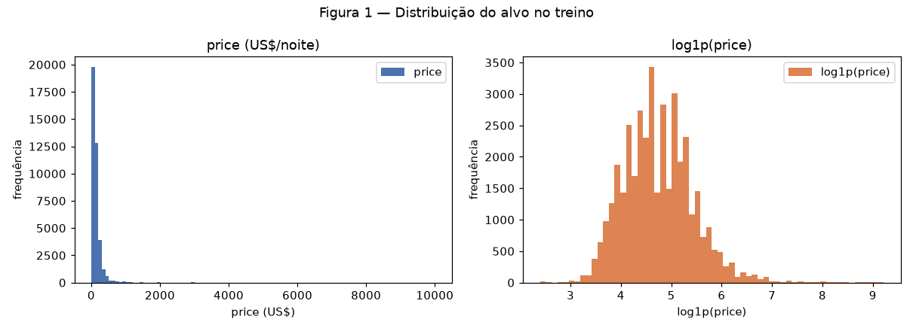
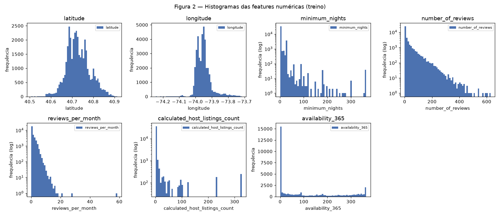
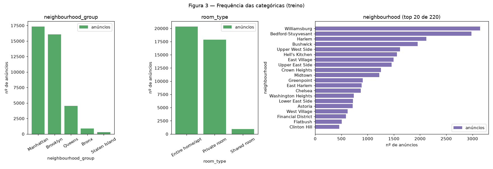
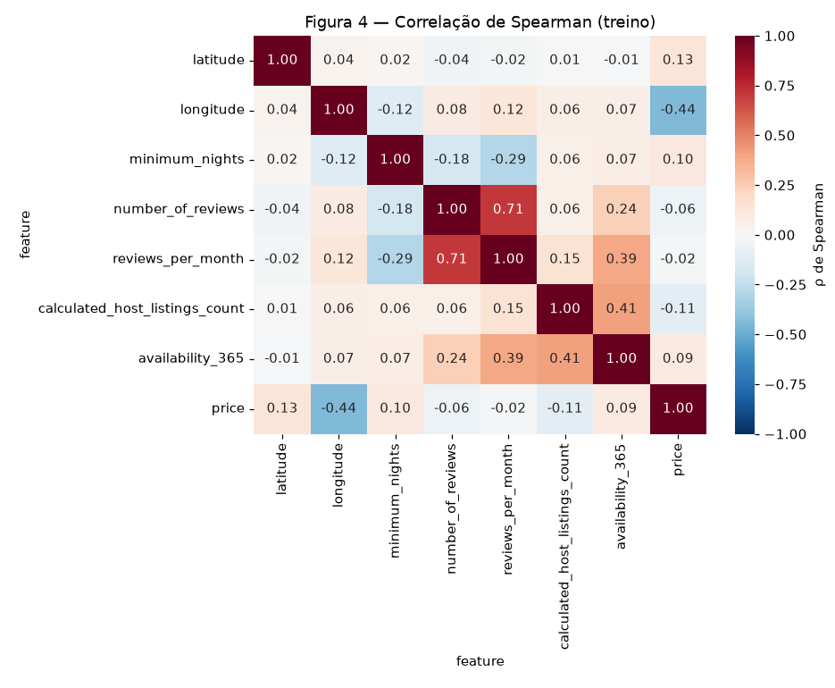
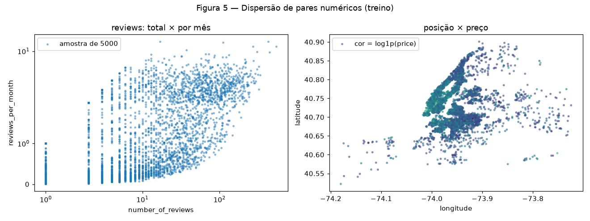
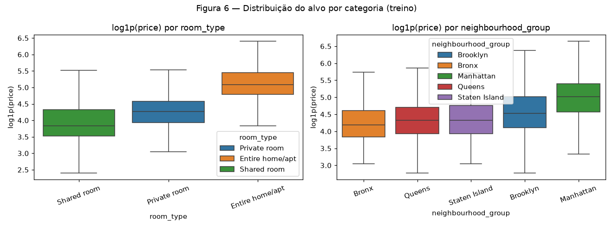
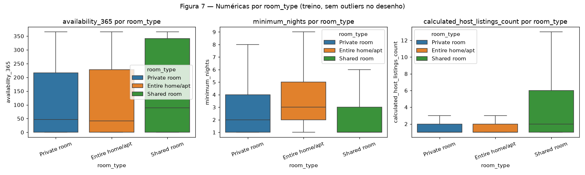
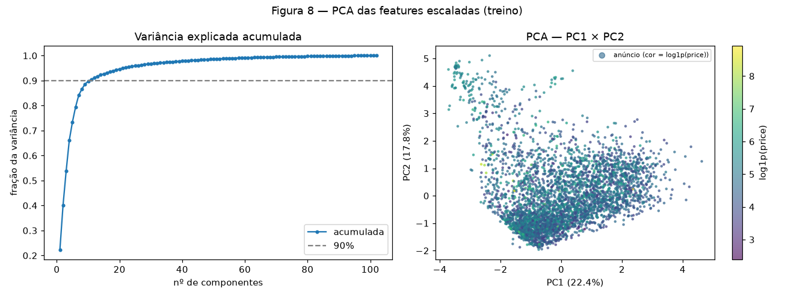
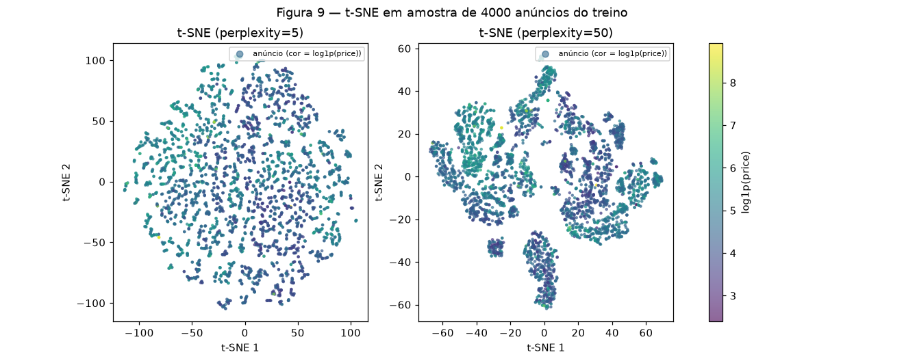
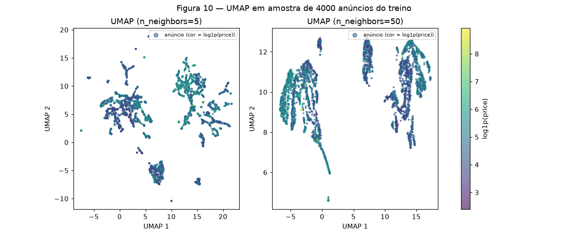

# 1. EDA — New York City Airbnb 2019

!!! info "Equipe"

    | Nome completo | GitHub |
    |---------------|--------|
    | Alex Chequer | [AlexChequer](https://github.com/AlexChequer) |
    | | [Lucasikawa](https://github.com/Lucasikawa) |
    | | [carloshernanic](https://github.com/carloshernanic) |

    Dataset, decisões e status: [página do projeto](../index.md).

**Como reproduzir** (da raiz do repositório, com `requirements.txt` instalado):

```shell
python docs/projects/eda/code/eda_figures.py   # Etapas 1–3: Figuras 1–7 e eda_numbers.json
python docs/projects/eda/code/dimred.py        # Etapa 4: Figuras 8–10 e dimred_numbers.json
python docs/projects/eda/code/pipeline.py      # Etapa 4C: shapes, NaN e nomes das features
```

Todos os números do texto saem desses scripts. `random_state=42` em tudo.

## 0. Proposal

| | |
|---|---|
| **Dataset** | New York City Airbnb Open Data (Inside Airbnb, via Kaggle — `AB_NYC_2019.csv`) |
| **Tamanho** | 48.895 linhas × 16 colunas |
| **Tarefa / alvo** | Regressão — `price` (US$ por noite) |
| **Features** | 7 numéricas + 3 categóricas usadas no modelo (as outras 5 colunas são IDs, texto livre ou data) |
| **Motivação** | Prever o preço da diária a partir de localização, tipo de quarto e histórico do anúncio. Mistura geografia, categorias de alta cardinalidade e contagens com cauda longa. |
| **Primeiro risco** | Alvo extremamente assimétrico (máximo de US$ 10.000, mediana de US$ 106). |

## 1. Initial inspection

### A. Data dictionary

**Fonte:** [Inside Airbnb](http://insideairbnb.com/), redistribuído no Kaggle por
dgomonov (licença CC0). Retrato dos anúncios ativos em Nova York em 2019 (última
avaliação registrada em 08/07/2019).

**Cada linha** é um anúncio (*listing*) do Airbnb em Nova York.

<!-- tabela: uma linha por coluna do CSV (16), com significado, tipo e unidade -->
| Feature | Significado | Tipo | Unidade |
|---------|-------------|------|---------|
| | | | |

### B. Quality

**Valores ausentes** (CSV original, 48.895 linhas):

| Coluna | Ausentes | % | Padrão | Tratamento |
|--------|---------:|--:|--------|------------|
| `last_review` | 10.052 | 20,56% | só falta quando `number_of_reviews == 0` | coluna descartada |
| `reviews_per_month` | 10.052 | 20,56% | idem — **não é aleatório**: anúncio sem review não tem taxa | imputar **0** |
| `host_name` | 21 | 0,04% | aleatório | coluna descartada |
| `name` | 16 | 0,03% | aleatório | coluna descartada |

Verificamos que `reviews_per_month` é NaN **exatamente** nas linhas com
`number_of_reviews == 0` (coincidência em 100% das linhas). Ou seja, a ausência significa
"zero reviews por mês", e 0 é o valor correto, não uma estimativa.

**Duplicatas:** 0 linhas duplicadas e 0 `id` repetidos.

**Valores impossíveis ou inconsistentes:**

- `price == 0`: **11 linhas**. Diária gratuita não existe; como é o alvo, essas linhas são
  removidas (antes do split, pois a regra não depende de estatística nenhuma).
- `minimum_nights > 365`: **14 linhas** (máximo 1.250). Estadia mínima de mais de um ano é
  inconsistente com aluguel por temporada; o valor é truncado em 365.
- `availability_365 == 0`: **17.533 linhas (35,9%)**. Não é impossível (anúncio bloqueado
  ou inativo), mas é um pico suspeito, mantido como está e anotado como risco (Etapa 5).

**Colunas descartadas:**

| Coluna | Motivo |
|--------|--------|
| `id` | identificador único, sem informação |
| `host_id` | identificador (37.457 hosts distintos); a informação útil já está em `calculated_host_listings_count` |
| `name`, `host_name` | texto livre / nome próprio; fora do escopo de um modelo tabular |
| `last_review` | data com 20,56% de ausentes; o histórico de reviews já está em `number_of_reviews` e `reviews_per_month` |

**Vazamento (*leakage*):** nenhuma coluna é derivada do preço. `number_of_reviews`,
`reviews_per_month` e `availability_365` são observadas **no mesmo momento** que o preço
(retrato de 2019), então estão disponíveis na hora de prever. Nenhuma feature tem
correlação suspeita com o alvo — a maior é |ρ| = 0,44 (`longitude`, Figura 4).

### C. Target

Estatísticas de `price` no treino (39.107 anúncios):

| Média | Mediana | Desvio | Mín | Máx | Assimetria | Assimetria de log1p |
|------:|--------:|-------:|----:|----:|-----------:|--------------------:|
| 153,30 | 106,00 | 245,16 | 10 | 10.000 | **19,22** | **0,64** |


/// caption
**Figura 1** — Histograma de `price` e de `log1p(price)` no treino.
///

O preço tem cauda direita muito longa: média 45% acima da mediana e 2,17% dos anúncios
acima de US$ 500. Com `log1p`, a assimetria cai de 19,22 para 0,64 e a distribuição fica
aproximadamente simétrica. **Conclusão:** a rede vai prever `log1p(price)`, senão a perda
(MSE) fica dominada por poucos anúncios de luxo.

### D. Train/test split

- 80% treino / 20% teste, `random_state=42`, sobre as 48.884 linhas após remover `price == 0`.
- **Estratificado por quintil de `log1p(price)`**: em regressão não há classe, então dividimos
  o alvo em 5 faixas para que treino e teste tenham a mesma distribuição de preço (inclusive
  a cauda).
- Não é temporal: o dataset é um retrato único de 2019, sem eixo de tempo para o alvo.
- **Treino: 39.107 · Teste: 9.777.** A partir daqui, toda estatística (Etapas 2–4) é
  calculada **só no treino**.

## 2. Univariate analysis

### A. Numerical

| Feature | Média | Mediana | Desvio | Q1 | Q3 | Mín | Máx | Assimetria |
|---------|------:|--------:|-------:|---:|---:|----:|----:|-----------:|
| `latitude` | 40,729 | 40,723 | 0,055 | 40,690 | 40,763 | 40,506 | 40,913 | 0,24 |
| `longitude` | −73,952 | −73,956 | 0,046 | −73,983 | −73,936 | −74,244 | −73,717 | 1,29 |
| `minimum_nights` | 6,97 | 3 | 17,65 | 1 | 5 | 1 | 365 | 11,95 |
| `number_of_reviews` | 23,25 | 5 | 44,26 | 1 | 24 | 0 | 629 | 3,69 |
| `reviews_per_month`* | 1,38 | 0,72 | 1,69 | 0,19 | 2,02 | 0,01 | 58,5 | 3,35 |
| `calculated_host_listings_count` | 7,02 | 1 | 32,41 | 1 | 2 | 1 | 327 | 8,03 |
| `availability_365` | 112,94 | 45 | 131,74 | 0 | 227 | 0 | 365 | 0,76 |

\* sem os NaN (31.083 valores).


/// caption
**Figura 2** — Histogramas das 7 numéricas no treino. Features com assimetria > 3 aparecem com
eixo y em escala log.
///

- **Latitude/longitude:** quase simétricas e unimodais (concentração em Manhattan/Brooklyn);
  a cauda de `longitude` (assimetria 1,29) é o Queens a leste. Não precisam de transformação.
- **Contagens com cauda longa** (`minimum_nights`, `number_of_reviews`, `reviews_per_month`,
  `calculated_host_listings_count`): assimetria entre 3,35 e 11,95, mediana muito abaixo da
  média e outliers extremos (ex.: um host com 327 anúncios). `minimum_nights` tem modas em
  1–3 e um pico em **30** (regra de NY para aluguel de longa duração).
- **`availability_365`:** limitada em [0, 365] e **bimodal** — pico em 0 e outro em 365.

**Conclusão:** as 4 contagens precisam de `log1p` + clip para não dominar a escala; as
coordenadas e `availability_365` só precisam de padronização.

### B. Categorical

| Feature | Cardinalidade | Frequências (treino) |
|---------|--------------:|----------------------|
| `room_type` | 3 | Entire home/apt 51,97% · Private room 45,69% · **Shared room 2,34%** |
| `neighbourhood_group` | 5 | Manhattan 44,28% · Brooklyn 41,10% · Queens 11,56% · **Bronx 2,30%** · **Staten Island 0,77%** |
| `neighbourhood` | **220** | top 5: Williamsburg 3.147, Bedford-Stuyvesant 2.981, Harlem 2.120, Bushwick 1.953, Upper West Side 1.617 |


/// caption
**Figura 3** — Frequência de `neighbourhood_group`, `room_type` e dos 20 bairros mais comuns.
///

- **Categorias raras:** `Shared room` (2,34%), `Bronx` (2,30%) e `Staten Island` (0,77%) têm
  poucos exemplos — o modelo verá pouco desses grupos.
- **Alta cardinalidade:** `neighbourhood` tem 220 bairros no treino, e **134 deles têm menos
  de 50 anúncios** (juntos, só 5,07% das linhas); 6 aparecem uma única vez. Um one-hot
  completo criaria 220 colunas quase todas vazias.
- Um bairro do teste (**New Dorp**) não aparece no treino.

**Conclusão:** `neighbourhood` precisa agrupar raros e tratar categorias novas (Etapa 4A).

## 3. Bivariate and multivariate analysis

### A. Numerical × numerical

Usamos **Spearman** em vez de Pearson: as contagens têm assimetria de até 11,95 e outliers
extremos (Etapa 2A), e Spearman mede relação monotônica pelos postos, sem ser puxado
por poucos valores gigantes. Exemplo: entre `number_of_reviews` e `reviews_per_month`,
Pearson dá 0,549 e Spearman 0,706.


/// caption
**Figura 4** — Matriz de correlação de Spearman (7 numéricas + `price`), treino.
///

Pares mais correlacionados:

| Par | ρ de Spearman |
|-----|--------------:|
| `number_of_reviews` × `reviews_per_month` | **0,706** |
| `calculated_host_listings_count` × `availability_365` | 0,407 |
| `reviews_per_month` × `availability_365` | 0,389 |

Com o alvo, a maior é `longitude` (ρ = −0,44: mais a leste, mais barato — sai de Manhattan),
seguida de `latitude` (0,13). As features de reviews quase não se relacionam com o preço
(|ρ| ≤ 0,06).

**Conclusão:** o único par **redundante** é `number_of_reviews` × `reviews_per_month`
(0,706). Mantemos os dois — 0,71 não é colinearidade perfeita e uma rede lida bem com
isso — mas fica registrado. Nenhum par passa de 0,8.


/// caption
**Figura 5** — Esquerda: `number_of_reviews` × `reviews_per_month` (escala symlog). Direita:
latitude × longitude colorido por `log1p(price)`. Amostra de 5.000 anúncios do treino.
///

**Conclusão:** à esquerda, a relação é monotônica mas larga (anúncios novos têm taxa alta
com poucos reviews totais), o que confirma redundância parcial. À direita, os preços mais
altos se concentram no sul de Manhattan — a localização é a informação numérica mais
importante para o preço.

### B. Categorical × target


/// caption
**Figura 6** — `log1p(price)` por `room_type` e por `neighbourhood_group`, treino (sem
outliers no desenho).
///

| `room_type` | Mediana (US$) | Média | IQR |
|-------------|--------------:|------:|----:|
| Entire home/apt | 160 | 212,2 | 110 |
| Private room | 70 | 90,6 | 46 |
| Shared room | 45 | 69,1 | 42 |

| `neighbourhood_group` | Mediana (US$) | Média | IQR |
|-----------------------|--------------:|------:|----:|
| Manhattan | 150 | 197,6 | 125 |
| Brooklyn | 91 | 125,6 | 90 |
| Queens | 75 | 98,8 | 60 |
| Staten Island | 75 | 102,7 | 65 |
| Bronx | 65 | 86,0 | 54 |

**Conclusão:** `room_type` é a categórica que mais separa o preço — a mediana de um
apartamento inteiro (US$ 160) é mais que o dobro da de um quarto privado (US$ 70). Entre
os distritos, Manhattan está claramente acima dos outros quatro, que se sobrepõem bastante.

### C. Numerical × categorical


/// caption
**Figura 7** — `availability_365`, `minimum_nights` e `calculated_host_listings_count` por
`room_type`, treino (sem outliers no desenho).
///

<!-- interpretar a Figura 7: diferença de posição (mediana) e de dispersão (IQR) entre os
3 tipos de quarto, para cada uma das 3 features, e fechar com uma conclusão explícita.
Os números estão em code/eda_numbers.json → "num_cat". -->

## 4. Preprocessing

### A. Strategies

Cada decisão vem de um achado anterior. Tudo é ajustado **só no treino** (`fit` no treino,
`transform` no teste) e está em [`code/pipeline.py`](#c-pipeline).

| # | Transformação | Features | Motivo |
|---|---------------|----------|--------|
| 1 | Remover linhas com `price == 0` (11) | alvo | valor impossível (1B) |
| 2 | Truncar `minimum_nights` em 365 (14 linhas) | `minimum_nights` | inconsistente (1B) |
| 3 | Descartar 5 colunas | `id`, `host_id`, `name`, `host_name`, `last_review` | IDs/texto/data (1B) |
| 4 | **Ausentes:** imputar **0** | `reviews_per_month` | NaN ⇔ zero reviews (1B) |
| 5 | **Outliers:** clip no **p99 do treino** | 4 contagens | caudas extremas (2A) |
| 6 | `log1p` | 4 contagens | assimetria 3,35–11,95 (2A) |
| 7 | **Escala:** `StandardScaler` | todas as 7 numéricas | escalas muito diferentes; rede neural |
| 8 | **Encoding:** one-hot, raros (< 50) → `infrequent`, desconhecidos → `infrequent` | 3 categóricas | 220 bairros, 134 raros, bairro novo no teste (2B) |
| 9 | Alvo = `log1p(price)` | `price` | assimetria 19,22 → 0,64 (1C) |

**Ausentes.** Imputar 0 em `reviews_per_month` não é palpite: a falta acontece
exatamente quando não há reviews.

**Outliers.** Não removemos linhas (seriam anúncios reais, e a rede vai encontrá-los no
teste). Em vez disso, cada contagem é cortada no percentil 99 **do treino**: `minimum_nights`
≤ 45, `number_of_reviews` ≤ 214, `reviews_per_month` ≤ 6,86,
`calculated_host_listings_count` ≤ 232. Isso afeta **1.345 linhas do treino (3,44%)**. Depois
do clip, `log1p` comprime o que sobra da cauda.

**Encoding.** `room_type` e `neighbourhood_group` têm poucas categorias → one-hot direto.
Para `neighbourhood`, usamos `OneHotEncoder(min_frequency=50,
handle_unknown="infrequent_if_exist")`: os 134 bairros com menos de 50 anúncios no treino
viram uma única coluna `neighbourhood_infrequent_sklearn`, e um bairro que só aparece no
teste (como **New Dorp**) cai nessa mesma coluna em vez de quebrar o pipeline ou virar
um vetor de zeros.

**Escala.** Uma rede neural treina mal com entradas em escalas diferentes (latitude varia
0,05; `availability_365` varia 130). `StandardScaler` deixa cada numérica com média 0 e
desvio 1 no treino. As colunas one-hot ficam em {0, 1}, já na faixa certa.

### B. Dimensionality reduction

Projeções das **102 features já pré-processadas** do treino, coloridas por `log1p(price)`.
PCA usa o treino inteiro; t-SNE e UMAP usam uma amostra de **4.000 anúncios** (custo
computacional), mesma amostra nas três figuras.


/// caption
**Figura 8** — Esquerda: variância explicada acumulada. Direita: PC1 × PC2.
///

**PCA.** PC1 explica **22,37%** e PC2 **17,76%** — juntos, **40,14%**. São necessários
**11 componentes** para 90%.

| Componente | Maiores *loadings* | Interpretação |
|------------|--------------------|---------------|
| PC1 | `reviews_per_month` (+0,61), `number_of_reviews` (+0,59), `minimum_nights` (−0,40) | **atividade do anúncio**: muitos reviews e estadia curta vs. poucos reviews e estadia longa |
| PC2 | `availability_365` (+0,62), `calculated_host_listings_count` (+0,60), `minimum_nights` (+0,38) | **perfil "profissional"**: host com muitos anúncios, sempre disponível |

As duas primeiras componentes só capturam features numéricas de comportamento do anúncio,
que quase não se relacionam com o preço (Figura 4). Por isso a cor da Figura 8 fica
misturada: **PCA não separa o preço** em 2D.


/// caption
**Figura 9** — t-SNE com `perplexity` = 5 e 50.
///


/// caption
**Figura 10** — UMAP com `n_neighbors` = 5 e 50 (`min_dist=0.1`).
///

**t-SNE e UMAP.** Com `perplexity=5` o t-SNE só preserva vizinhança muito local e vira uma
nuvem sem estrutura; com `perplexity=50` aparecem grupos bem definidos. No UMAP,
`n_neighbors=5` gera muitos fragmentos pequenos, e `n_neighbors=50` junta tudo em
poucos grupos grandes. Conferimos a composição dos grupos (k-means com k = 6 sobre o UMAP
`n_neighbors=50`): cada grupo é praticamente **um único distrito** (`neighbourhood_group`),
enquanto `room_type` aparece misturado dentro de todos eles. Ou seja, a estrutura vem das
colunas one-hot de localização. Dentro dos grupos, a cor (preço) varia bastante.

**Comparação.** O PCA é linear e prioriza a direção de **maior variância**, que aqui é o
comportamento de reviews, não o preço. t-SNE e UMAP preservam **vizinhança**, então revelam
que os anúncios formam grupos discretos por distrito — estrutura que o PCA espalha.
Mas mesmo esses grupos não separam o preço sozinhos: o preço depende também de
`room_type`, que está misturado dentro de cada grupo (Figura 6). Cuidado: em t-SNE/UMAP o **tamanho** dos grupos
e a **distância** entre eles não têm significado direto; só vale "quem está perto de quem".

### C. Pipeline

`Pipeline` + `ColumnTransformer` em
[`docs/projects/eda/code/pipeline.py`](https://github.com/AlexChequer/ann-dl-project/blob/main/docs/projects/eda/code/pipeline.py),
importável da raiz do repositório:

```python
from docs.projects.eda.code.pipeline import load_split, build_preprocessor, transform_target
X_train, X_test, y_train, y_test = load_split()
pre = build_preprocessor().fit(X_train)          # fit só no treino
Xt_train, Xt_test = pre.transform(X_train), pre.transform(X_test)
y_train_model = transform_target(y_train)        # log1p(price)
```

??? example "code/pipeline.py"

    ```python
    --8<-- "docs/projects/eda/code/pipeline.py"
    ```

**Resultado** (`python docs/projects/eda/code/pipeline.py`):

- NaN restantes: **0** no treino e **0** no teste.
- Shape final: treino **(39.107, 102)**, teste **(9.777, 102)**.
- 102 features = **7 numéricas** + **95 one-hot**: 5 de `neighbourhood_group`, 87 de
  `neighbourhood` (86 bairros com ≥ 50 anúncios + `neighbourhood_infrequent_sklearn`) e 3 de
  `room_type`.

Nomes: `latitude`, `longitude`, `minimum_nights`, `number_of_reviews`,
`reviews_per_month`, `calculated_host_listings_count`, `availability_365`,
`neighbourhood_group_{Bronx, Brooklyn, Manhattan, Queens, Staten Island}`,
`neighbourhood_{Arverne, Astoria, …, Woodside}` (86),
`neighbourhood_infrequent_sklearn`,
`room_type_{Entire home/apt, Private room, Shared room}`. A lista completa é impressa pelo
script.

## 5. Synthesis

### Principais achados

1. **O alvo precisa de `log1p`.** Assimetria 19,22 → 0,64 (Figura 1).
2. **Localização e tipo de quarto mandam no preço.** `longitude` tem ρ = −0,44 com o preço
   (Figura 4) e o sul de Manhattan concentra os caros (Figura 5); um apartamento inteiro tem
   mediana US$ 160 contra US$ 70 de um quarto privado (Figura 6).
3. **Features de review quase não explicam preço** (|ρ| ≤ 0,06, Figura 4), mas dominam a
   variância — por isso PC1 + PC2 (40,14%) não separam o preço (Figura 8).
4. **Ausência informativa:** `reviews_per_month` falta exatamente quando não há review
   (tabela da 1B) → imputar 0.
5. **Bairros de alta cardinalidade:** 220 bairros, 134 com < 50 anúncios (Figura 3) → agrupar raros.
6. **Estrutura não linear:** t-SNE/UMAP mostram grupos por distrito que o PCA não mostra
   (Figuras 8–10), mas nenhuma projeção 2D separa o preço — o modelo terá de combinar
   localização e `room_type` de forma não linear (MLP).

### Riscos e plano

| Risco | Plano |
|-------|-------|
| Cauda do preço (até US$ 10.000) domina a perda | treinar em `log1p(price)`; avaliar também MAE em US$ |
| Pouca informação para prever preço (maior ρ é 0,44) | aceitar erro alto; comparar com baseline que prevê a mediana do treino |
| 35,9% com `availability_365 == 0` (anúncios inativos?) | manter; na entrega 2, testar uma flag binária `available == 0` |
| Categorias raras (Shared room 2,34%, Staten Island 0,77%) | reportar erro por grupo na entrega 2 |
| Bairros novos no teste/produção | já tratado: `handle_unknown="infrequent_if_exist"` |
| Texto de `name` descartado (pode ter informação: "luxury", "studio") | fora do escopo agora; possível extensão |

### Results summary

| # | Item | Valor |
|---|------|-------|
| 1 | Dataset, tarefa e alvo | NYC Airbnb 2019 · regressão · `price` (modelado como `log1p(price)`) |
| 2 | Instâncias × features (num / cat) | 48.895 × 16 no CSV; modelo usa 7 numéricas / 3 categóricas |
| 3 | Coluna com mais ausentes | `last_review` e `reviews_per_month` — 20,56% (10.052) |
| 4 | Colunas descartadas e motivo | `id`, `host_id` (IDs), `name`, `host_name` (texto), `last_review` (data, 20,56% NaN, redundante) |
| 5 | Média e mediana do alvo | US$ 153,30 e US$ 106,00 (treino) |
| 6 | Tamanho treino / teste | 39.107 / 9.777 |
| 7 | Par numérico mais correlacionado | `number_of_reviews` × `reviews_per_month`, ρ = 0,706 |
| 8 | Linhas afetadas pela estratégia de outliers | 1.345 linhas do treino (3,44%) cortadas no p99 |
| 9 | Variância de PC1 + PC2 | 40,14% |
| 10 | Shapes após o pipeline | treino (39.107, 102) · teste (9.777, 102) |
