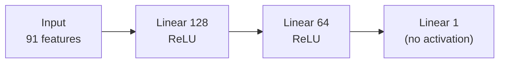
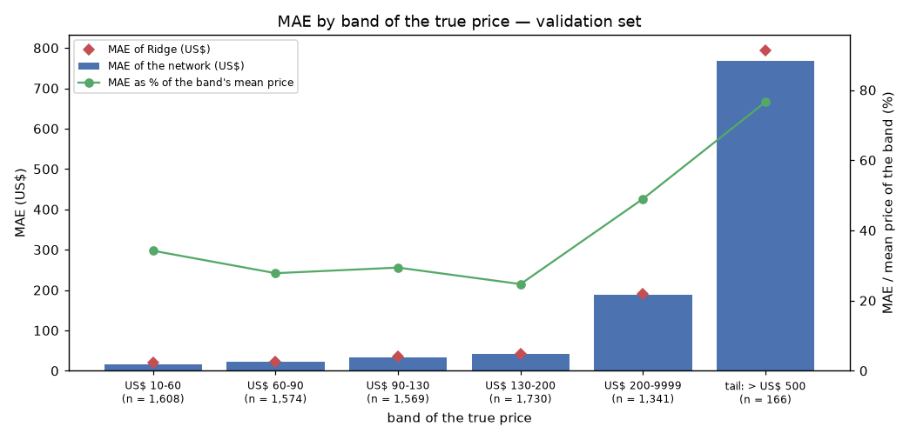
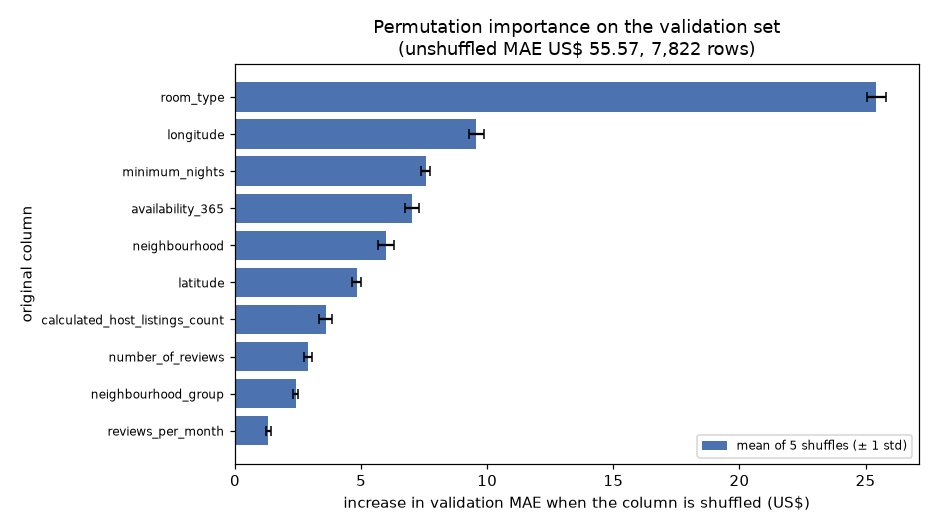

# 2. Regression — New York City Airbnb 2019

!!! info "Team"

    | Full name | GitHub |
    |-----------|--------|
    | Alex Chequer | [AlexChequer](https://github.com/AlexChequer) |
    | Lucas Ikawa | [Lucasikawa](https://github.com/Lucasikawa) |
    | Carlos Hernani Cardoso | [carloshernanic](https://github.com/carloshernanic) |

    Dataset, decisions and status: [project page](../index.md). Previous deliverable:
    [EDA](../eda/index.md).

**How to reproduce** (from the repository root, with `requirements.txt` installed):

```shell
python docs/projects/regression/code/baselines.py      # Stage 1: baselines_numbers.json
python docs/projects/regression/code/train.py          # Stages 2–3: Figures 1–2 and train_numbers.json
python docs/projects/regression/code/error_analysis.py # Stage 6: Figures 6–8 and error_numbers.json
```

Every number in the text comes from these scripts. Seed 42 everywhere (split, weight
initialization and batch order).

## 0 · Starting point

**Pipeline.** The EDA pipeline is **imported, not copied**:
[`code/data.py`](https://github.com/AlexChequer/ann-dl-project/blob/main/docs/projects/regression/code/data.py)
imports `load_split`, `build_preprocessor` and `transform_target` from
[`docs/projects/eda/code/pipeline.py`](../eda/index.md#c-pipeline). Same dataset, same task
(regression on `price`), same 80/20 split with `random_state=42`, so the test set has the
same **9,777** listings as in the EDA.

??? example "code/data.py"

    ```python
    --8<-- "docs/projects/regression/code/data.py"
    ```

**What changed since the EDA, and why:**

| Change | Reason |
|--------|--------|
| A **validation set** is taken from the EDA training set: 20% of it, stratified by `log1p(price)` quintile (same rule as the train/test split), seed 42 | every choice in Stages 1–4 is made on validation, so the test set is used only once, in Stage 5 |
| The preprocessor is **fitted on the new, smaller training set** (31,285 rows), not on the 39,107 rows of the EDA | fitting on rows that are now validation would leak their statistics (p99 clips, scaler means, category frequencies) |
| The model sees **91 features instead of 102** | consequence of the line above: with fewer training rows, only 75 neighbourhoods (instead of 86) reach the 50-listing minimum; the others fall into `neighbourhood_infrequent_sklearn`. 91 = 7 numerical + 5 boroughs + 76 neighbourhood columns + 3 room types |
| The test set is only loaded with `load_data(with_test=True)` | prevents an accidental use of the test set before Stage 5 |

| Set | Rows | Mean price (US$) | Median price (US$) |
|-----|-----:|-----------------:|-------------------:|
| Train | **31,285** | 154.06 | 106 |
| Validation | **7,822** | 150.25 | 106 |
| Test | **9,777** | not looked at until Stage 5 | — |

There are 0 NaN after the pipeline in train and validation.

**Target.** The network predicts `log1p(price)` (EDA, Stage 1C: skewness 19.22 → 0.64).
Every metric below is computed **in US$**, after inverting with `expm1`.

**Main metric: MAE in US$**, on the original scale. Reasons: (1) it reads directly as "the
prediction is off by US$ X per night on average"; (2) the EDA showed a price tail up to
US$ 10,000, and RMSE and R² in US$ are dominated by those few listings, so they would mostly
measure the luxury tail and not the typical listing. RMSE and R² are still reported, as
required.

**Success criterion, set before training any network:** the network's **MAE on the test set
must be at least 5% lower than the MAE of the best baseline** on the same test set. Why 5%
and not more: the EDA found little signal (largest |ρ| with the target is 0.44) and the
strongest effects — room type and borough — are additive in log scale, which a linear model
already captures. What is left for the network is the nonlinear part: the price surface over
latitude × longitude and its interaction with room type (EDA, Figure 5).

## 1 · Baselines

Both baselines use **the same pipeline and the same target** as the network: fitted on
`log1p(price)` with the 91 features, predictions converted back to US$, evaluated on the
**validation** set.

- **Trivial:** `DummyRegressor(strategy="mean")` — predicts the training mean of
  `log1p(price)` for every listing.
- **Linear:** `Ridge(alpha=1.0)` — linear regression with L2, because the 76 one-hot
  neighbourhood columns are sparse and correlated with the borough columns.

??? example "code/baselines.py"

    ```python
    --8<-- "docs/projects/regression/code/baselines.py"
    ```

| Baseline (validation) | MAE (US$) | RMSE (US$) | R² (US$) | RMSE in log |
|-----------------------|----------:|-----------:|---------:|------------:|
| Dummy (mean) | 81.78 | 218.16 | −0.029 | 0.687 |
| **Ridge** | **57.85** | 200.96 | 0.127 | 0.458 |

**Reading.**

- Ridge cuts the MAE of the trivial baseline by **29.3%** (81.78 → 57.85): room type and
  location alone already explain a large part of the price, as the EDA suggested (Figure 6).
- In log scale Ridge is much better than its R² in US$ suggests: the RMSE in log drops from
  0.687 to 0.458, which is **55.5% of the variance of `log1p(price)` explained**
  (1 − 0.458² / 0.687²). The R² in US$ is only 0.127 because the squared error in US$ is
  dominated by the luxury tail, which no feature here explains. This confirms the choice of
  MAE as the main metric.
- The Dummy has a slightly negative R² in US$ (−0.029) because it predicts the mean of the
  log, which after `expm1` is below the arithmetic mean that R² uses as reference.
- **Best baseline: Ridge, MAE US$ 57.85 on validation.** This is the number the network has
  to beat.

## 2 · The network

MLP in **PyTorch**, in
[`code/model.py`](https://github.com/AlexChequer/ann-dl-project/blob/main/docs/projects/regression/code/model.py).



| | Choice | Why |
|---|--------|-----|
| Hidden layers | 2 | one hidden layer can already bend the linear solution; the second lets the network combine location with room type, the interaction the EDA pointed to. Other depths are tested in Stage 4 |
| Widths | 128 → 64 | first layer wider than the input (91) so that the sparse one-hot columns are not squeezed right away; then it narrows towards the single output |
| Activation | ReLU | cheap, does not saturate for positive inputs, standard for tabular MLPs |
| Initialization | He (Kaiming) normal, biases at 0 | designed for ReLU: keeps the variance of the activations stable from layer to layer |
| Output | 1 linear unit | regression: `log1p(price)` is an unbounded real number, so no activation |
| Loss | Huber (δ = 1) on `log1p(price)` | see below |

**Loss, justified by the EDA outliers.** Even after the log, the target keeps a right tail
(skewness 0.64; 2.17% of the EDA training listings cost more than US$ 500) that the features
do not explain. With MSE, those few listings would produce the largest gradients. Huber is
quadratic for errors below 1 log unit (a factor of about 2.7 in price) and linear above
that, so ordinary listings are treated as in MSE and the tail is treated as in MAE — which
also matches the main metric.

**Size.** The network has **20,097 parameters** (91·128 + 128 = 11,776; 128·64 + 64 = 8,256;
64 + 1 = 65) for **31,285 training rows** — 0.64 parameter per row. It has far more capacity
than Ridge (92 parameters) and could overfit, so early stopping (Stage 3) and regularization
(Stage 4) are needed, but it still has fewer parameters than training rows.

??? example "code/model.py"

    ```python
    --8<-- "docs/projects/regression/code/model.py"
    ```

## 3 · Training

The loop is `train_model` in
[`code/train.py`](https://github.com/AlexChequer/ann-dl-project/blob/main/docs/projects/regression/code/train.py);
Stages 4 and 5 reuse the same function.

| | Choice | Why |
|---|--------|-----|
| Optimizer | Adam (`AdamW` with `weight_decay=0`) | adapts the step per parameter, which matters here: the one-hot columns of rare neighbourhoods get a gradient in very few batches, while the 7 numerical features get one in every batch. Using `AdamW` lets Stage 4 turn on weight decay without changing the code |
| Learning rate | 1e-3 | compared with 1e-2 and 1e-4 below (Figure 2) |
| Batch size | 256 | 123 updates per epoch on 31,285 rows: enough updates to converge in few epochs, with batches large enough for a stable curve |
| Maximum epochs | 200 | only an upper limit; early stopping decides |
| Early stopping | patience 15 on the **validation loss**, best weights restored | the validation loss oscillates between epochs (Figure 1), so stopping at the first bad epoch would stop on noise; 15 epochs separates noise from a real upward trend |

??? example "code/train.py"

    ```python
    --8<-- "docs/projects/regression/code/train.py"
    ```


/// caption
**Figure 1** — Huber loss on `log1p(price)` per epoch, training and validation, base network
(no regularization; log-scale y axis). The dashed line marks the epoch with the best
validation loss.
///

**Reading Figure 1.**

- **It converges, and fast.** The training loss falls from 0.786 in epoch 1 to 0.099 in
  epoch 4; the validation loss goes from 0.152 to 0.096 in the same 4 epochs. After that the
  gains are in the third decimal place.
- **Best epoch: 18** (validation loss **0.0899**, training loss 0.0869). Training stopped at
  epoch **33**, after 15 epochs with no improvement, and the weights of epoch 18 were
  restored.
- **Overfitting starts right after epoch 18, and it is mild.** From epoch 18 to 33 the
  training loss keeps falling (0.0869 → 0.0832) while the validation loss rises
  (0.0899 → 0.0915): the gap between the curves grows from 0.003 to 0.008.
- The small gap says the base network is **not limited by overfitting**. Training and
  validation losses are almost the same, so what limits the model is the information in the
  features (the EDA already expected a high error), not the capacity of the network.


/// caption
**Figure 2** — Validation loss per epoch for three learning rates (same network, same seed;
log-scale y axis).
///

| Learning rate | Best epoch | Stopped at | Best validation loss | Validation MAE (US$) |
|--------------:|-----------:|-----------:|---------------------:|---------------------:|
| 1e-2 | 23 | 38 | 0.0910 | 55.91 |
| **1e-3** | **18** | **33** | 0.0899 | **55.57** |
| 1e-4 | 129 | 144 | 0.0890 | 55.80 |

**Reading Figure 2.** With 1e-2 the validation loss is noisy — after epoch 5 it still jumps
between 0.091 and 0.110, while with 1e-3 it stays between 0.090 and 0.094 — and its best
value is the worst of the three (0.0910). With 1e-4 the curve is smooth and reaches the lowest loss
(0.0890), but it needs **129 epochs** — 7 times more than 1e-3 — and its MAE in US$ is not
better (55.80 against 55.57). **1e-3** gives the best MAE for a fraction of the cost, so it
is the base value; the learning rate is searched again in Stage 4 together with
regularization.

**Base network against the baselines (validation):**

| Model | MAE (US$) | RMSE (US$) | R² (US$) | RMSE in log |
|-------|----------:|-----------:|---------:|------------:|
| Dummy (mean) | 81.78 | 218.16 | −0.029 | 0.687 |
| Ridge | 57.85 | 200.96 | 0.127 | 0.458 |
| **MLP, base** | **55.57** | 198.30 | 0.149 | 0.440 |

The base network has a validation MAE **3.9% lower** than Ridge (57.85 → 55.57). On the
training set its MAE is 57.37 — higher than on validation because the training set holds
more of the extreme listings (training RMSE 235.24 against 198.30), not because of
underfitting on validation. The 3.9% is **below the 5% criterion** of Stage 0: the base
network alone would not meet it. Whether the final network meets it is decided on the test
set, in Stage 5.

## 4 · Regularization and hyperparameters

<!-- ALEX. Two or more techniques (weight decay, dropout, BatchNorm) each compared with the
base network of Stage 3 (validation MAE 55.57). Search of 8+ configurations chosen BY
VALIDATION, in a table sorted by validation MAE. Script: code/search.py, writes
code/search_numbers.json and code/best_config.json. -->

## 5 · Test evaluation

<!-- ALEX. Chosen configuration retrained and evaluated ONCE on the test set: MAE, RMSE, R²
in US$. Table with the network, Dummy and Ridge on the same test set. Was the Stage 0
criterion (MAE at least 5% below the best baseline) met? 3+ seeds (mean ± std). Mandatory
figures: predicted × actual and residuals × predicted. Script: code/evaluate.py, writes
code/test_numbers.json and code/test_predictions.csv. -->

## 6 · Error analysis

The analysis runs on the **validation** set with the base network of Stage 3 (MAE
US$ 55.57, against US$ 57.85 for Ridge). The permutation importance below shuffles ten
columns five times each: that is a repeated probe, not a single evaluation, so it belongs
on validation — the test set is read once, in Stage 5.

Every subgroup is also measured against **Ridge** on the same rows. "The network errs more
here" only means something next to what the linear baseline does with the same listings.
**Bias** is the mean of (prediction − true price): negative means the network asks for less
than the listing charges.

??? example "code/error_analysis.py"

    ```python
    --8<-- "docs/projects/regression/code/error_analysis.py"
    ```

### A. Error by subgroup

| `room_type` | Rows | MAE (US$) | Ridge (US$) | Gain | Mean price | MAE / price | Bias (US$) |
|-------------|-----:|----------:|------------:|-----:|-----------:|------------:|-----------:|
| Entire home/apt | 4,086 | 76.63 | 79.30 | 3.4% | 205.54 | 37.3% | −32.19 |
| Private room | 3,551 | 32.43 | 34.27 | 5.4% | 90.63 | 35.8% | −15.65 |
| **Shared room** | **185** | 34.51 | 36.55 | 5.6% | 73.55 | **46.9%** | −20.81 |

| `neighbourhood_group` | Rows | MAE (US$) | Ridge (US$) | Gain | Mean price | MAE / price | Bias (US$) |
|-----------------------|-----:|----------:|------------:|-----:|-----------:|------------:|-----------:|
| Manhattan | 3,479 | 75.74 | 79.12 | 4.3% | 195.04 | 38.8% | −33.33 |
| Brooklyn | 3,207 | 41.52 | 43.05 | 3.5% | 120.38 | 34.5% | −17.27 |
| Queens | 884 | 34.14 | 35.78 | 4.6% | 100.52 | 34.0% | −19.21 |
| **Bronx** | **196** | 28.24 | 27.35 | **−3.2%** | 81.15 | 34.8% | −7.48 |
| **Staten Island** | **56** | 40.72 | 38.92 | **−4.6%** | 105.20 | 38.7% | −20.47 |

| `availability_365` | Rows | MAE (US$) | Ridge (US$) | Gain | Mean price | MAE / price | Bias (US$) |
|--------------------|-----:|----------:|------------:|-----:|-----------:|------------:|-----------:|
| `== 0` | 2,787 | 43.20 | 45.36 | 4.8% | 128.96 | 33.5% | −16.42 |
| `> 0` | 5,035 | 62.41 | 64.76 | 3.6% | 162.04 | 38.5% | −28.83 |


/// caption
**Figure 6** — MAE in US$ by room type and by borough, validation set. Bars are the
network, red diamonds are Ridge on the same rows, and the dashed line is the MAE over all
7,822 rows (US$ 55.57).
///

**Reading Figure 6.**

- **MAE in US$ tracks the price level, not rarity.** Entire home/apt has the largest MAE
  (76.63) only because it is the most expensive group (mean US$ 205.54); its *relative*
  error, 37.3%, is close to Private room's 35.8%. Reading the subgroups in US$ alone would
  put the blame on the biggest, best-represented group — which is why the table carries
  MAE / mean price.
- **Where rarity does show up is the relative error of Shared room: 46.9%**, 11 points
  above Private room (35.8%) at a comparable price level (US$ 73.55 against US$ 90.63).
  *Hypothesis:* with 2.34% of the training rows (EDA, Stage 2B) the network has little
  evidence for this level and falls back on something close to the room-type average. The
  price band of comparable listings (US$ 60–90) errs by 27.8%, so the 46.9% is not simply
  "cheap listings are harder".
- **The two rarest boroughs are the only groups where the network loses to Ridge:** Bronx
  −3.2% and Staten Island −4.6%, against gains of 3.4% to 5.6% everywhere else.
  *Hypothesis:* the network's gain comes from bending the price surface locally, which
  needs enough listings per region; in the two boroughs the EDA flagged as rare (2.30% and
  0.77% of the dataset) there is not enough local evidence, and the extra flexibility costs
  more than it earns. With 56 rows, Staten Island alone is US$ 1.80 of difference and is
  not reliable; the Bronx, with 196 rows, points the same way.
- **`availability_365 == 0` is not a harder subgroup.** The EDA flagged these 35.9% of
  listings as suspicious; they are 35.63% of validation, and they err *less*, both in US$
  (43.20 against 62.41) and relatively (33.5% against 38.5%). *Hypothesis:* the flag marks
  cheaper listings (mean US$ 128.96 against US$ 162.04) rather than harder ones. The column
  still carries signal — it is fourth in the permutation ranking below.

### B. Error by band of the true price

| Band of the true price | Rows | MAE (US$) | Ridge (US$) | Gain | Mean price | MAE / price | Bias (US$) |
|------------------------|-----:|----------:|------------:|-----:|-----------:|------------:|-----------:|
| US$ 10–60 | 1,608 | 16.11 | 19.87 | **18.9%** | 47.15 | 34.2% | **+14.30** |
| US$ 60–90 | 1,574 | 21.29 | 23.07 | 7.7% | 76.56 | 27.8% | +7.40 |
| US$ 90–130 | 1,569 | 32.34 | 35.88 | 9.9% | 110.06 | 29.4% | +11.99 |
| US$ 130–200 | 1,730 | 41.38 | 41.77 | 0.9% | 167.81 | 24.7% | −6.35 |
| US$ 200–9,999 | 1,341 | 188.59 | 190.65 | 1.1% | 384.76 | 49.0% | −174.06 |
| *tail: > US$ 500* | *166* | **768.74** | 793.06 | 3.1% | 1,003.86 | **76.6%** | **−768.74** |

The last row is the luxury tail, already contained in the top band; it is listed apart
because the EDA singled it out.


/// caption
**Figure 7** — MAE in US$ by band of the true price, validation set (bars: network;
diamonds: Ridge; green line, right axis: MAE as a percentage of the band's mean price).
Bands are the quintiles of the true price; the last column is the tail above US$ 500.
///

**Reading Figure 7.**

- **The network under-predicts, and the bias grows with the price.** The bias goes from
  **+14.30** in the cheapest band to **−174.06** in the top one. In the tail it is
  **−768.74 — exactly minus the MAE**, which can only happen if *every one of the 166
  listings above US$ 500 is predicted below its price*.
- *Hypothesis:* the target is `log1p(price)` under a Huber loss, so a listing priced at
  US$ 1,000 predicted at US$ 300 costs about the same as one at US$ 100 predicted at
  US$ 30. With features that do not explain the tail (EDA: largest |ρ| is 0.44), the
  cheapest thing the optimizer can do is sit near the conditional median of the log, which
  in US$ is far below the tail. This is the same argument that made MAE the main metric in
  Stage 0, now visible per band.
- **The network's gain over Ridge lives in the cheap bands and vanishes at the top:**
  18.9% in US$ 10–60 and 9.9% in US$ 90–130, against 0.9% and 1.1% in the two most
  expensive bands. The nonlinearity the network adds is worth real percentage points where
  the prices are small, and almost nothing where the dollars are.
- The U shape of the relative error (34.2% → 24.7% → 49.0% → 76.6%) says the model is at
  its best in the US$ 130–200 band, which is where the bias crosses zero.

### C. The ten worst predictions

| Row | True (US$) | Predicted (US$) | Error | Room type | Borough · neighbourhood | Min. nights | Reviews | Availability |
|----:|-----------:|----------------:|------:|-----------|-------------------------|------------:|--------:|-------------:|
| 12342 | 9,999 | 82.8 | 9,916.2 | Private room | Manhattan · Lower East Side | 99 | 6 | 83 |
| 44034 | 6,800 | 537.6 | 6,262.4 | Entire home/apt | Manhattan · Chelsea | 1 | **0** | 364 |
| 2698 | 5,000 | 371.1 | 4,628.9 | Entire home/apt | Manhattan · Nolita | 1 | 2 | 365 |
| 29663 | 3,518 | 326.2 | 3,191.8 | Entire home/apt | Manhattan · East Village | 1 | **0** | 215 |
| 28727 | 3,000 | 75.6 | 2,924.4 | Private room | Brooklyn · Brighton Beach | 1 | **0** | 90 |
| 38498 | 2,999 | 189.9 | 2,809.1 | Entire home/apt | Manhattan · Upper West Side | 1 | **0** | 0 |
| 46533 | 2,995 | 206.6 | 2,788.4 | Entire home/apt | Manhattan · Chelsea | 30 | 1 | 214 |
| 22992 | 2,900 | 313.8 | 2,586.2 | Entire home/apt | Manhattan · Upper West Side | 1 | **0** | 180 |
| 29665 | 2,626 | 227.3 | 2,398.7 | Entire home/apt | Brooklyn · Park Slope | 1 | **0** | 31 |
| 45710 | 2,500 | 192.2 | 2,307.8 | Entire home/apt | Manhattan · Hell's Kitchen | 70 | **0** | 191 |

Row numbers are lines of `data/AB_NYC_2019.csv`, counting from 0.

**Reading.** All ten are under-predictions, all cost at least US$ 2,500, and the network
never goes above US$ 537.6 on any of them. Two patterns, each with a number behind it:

- **Seven of the ten have zero reviews**, against 20.56% of the dataset (EDA, Stage 1B:
  `last_review` is missing exactly when `number_of_reviews == 0`). *Hypothesis:* these are
  not listings the market priced — they are placeholders or blocked calendars, where the
  host types a deterrent price. The dataset has no "was it ever booked" column, so nothing
  in the features can separate them from a real luxury listing, and no model trained on
  these ten features will predict them.
- **The extreme case is row 12342: a Private room in Lower East Side at US$ 9,999 with a
  99-night minimum.** A private room at ten thousand dollars a night with a three-month
  minimum stay is not a product; the network predicts US$ 82.8, which is the right answer
  for the features it can see.
- Eight of the ten are in Manhattan and eight are Entire home/apt — the two levels with the
  highest mean price, which is where a tail can exist at all.

### D. Permutation importance


/// caption
**Figure 8** — Increase in validation MAE when one original column is shuffled, mean of 5
shuffles (error bars: ± 1 standard deviation). The 10 original columns are shuffled, not
the 91 model columns, so one shuffle moves every one-hot column the feature produces.
///

| Original column | Δ MAE (US$) | ± std | EDA, Spearman with price |
|-----------------|------------:|------:|-------------------------:|
| `room_type` | **25.43** | 0.38 | categorical |
| `longitude` | 9.57 | 0.31 | −0.439 |
| `minimum_nights` | 7.56 | 0.17 | 0.102 |
| `availability_365` | 7.02 | 0.27 | 0.086 |
| `neighbourhood` | 5.98 | 0.32 | categorical |
| `latitude` | 4.83 | 0.18 | 0.132 |
| `calculated_host_listings_count` | 3.59 | 0.25 | −0.108 |
| `number_of_reviews` | 2.90 | 0.17 | −0.057 |
| `neighbourhood_group` | 2.40 | 0.12 | categorical |
| `reviews_per_month` | 1.32 | 0.10 | −0.021 |

**Does it confirm the EDA? Yes, with one caveat about how the question is asked.**

- **`room_type` dominates: +25.43, 2.7 times the next column.** The EDA concluded that
  `room_type` is "the categorical feature that separates price the most" (Stage 3B). The
  network agrees, and by a wide margin.
- **Location is confirmed as well, but it is split over four columns.** The EDA called
  location "the most important numerical information for the price" (Stage 3A, Figure 5).
  Here `longitude` leads the numerical columns at +9.57, as its |ρ| = 0.44 predicted — but
  `longitude`, `neighbourhood`, `latitude` and `neighbourhood_group` together sum to
  **+22.78**, close to `room_type` on its own. *Caveat:* permuting one column at a time
  splits the credit among correlated columns, so it understates any feature that the
  pipeline spreads out. `neighbourhood_group` is the clearest case: shuffling it costs only
  +2.40 because the 76 `neighbourhood` columns still carry the borough.
- **Reviews are last, as the EDA predicted, but not at zero.** `number_of_reviews` (+2.90)
  and `reviews_per_month` (+1.32) are the smallest numerical contributions, matching
  |ρ| ≤ 0.06 in the EDA. That they are not zero is consistent with Section C: zero reviews
  is a weak marker of a listing that was never transacted, and the network does use it.
- `minimum_nights` at +7.56 is the one ranking the EDA did not anticipate: its |ρ| is only
  0.102, the third smallest. A monotonic correlation does not see a feature that matters
  only through a nonlinear rule — a one-night minimum and a 99-night minimum describe
  different products at the same price point.

## 7 · Conclusion

**Was the network worth it?** On validation, against the best baseline: MAE US$ 55.57
against Ridge's US$ 57.85, **3.9% lower**. The cost of that 3.9% is 20,097 parameters
against 92, a PyTorch dependency, and a training loop with early stopping instead of a
closed-form fit. Section 6B says where the 3.9% comes from: **18.9% in the US$ 10–60 band
and 9.9% in US$ 90–130, against 0.9% and 1.1% in the two most expensive bands.** The
network buys accuracy where the prices are small in absolute terms, which is worth little
in dollars; on the listings where an error costs the most, it matches the linear model. And
on the two rarest boroughs it is *worse* than Ridge. The honest summary for this network is
that it is a marginal improvement that has not met the 5% criterion set in Stage 0.

**Limitations.**

- **The data is from 2019.** It is a pre-pandemic snapshot of a market that has since
  changed in level and in regulation; nothing here transfers to today's prices without
  being refitted.
- **The listing text was dropped.** `name` is the one column that carries words like
  "luxury", "penthouse" or "loft", which is exactly the information missing to explain the
  tail that Section 6B and 6C showed the network cannot reach.
- **There is no outcome column.** Nothing says whether a listing was ever booked, so a
  placeholder at US$ 9,999 and a real luxury listing are identical to the model. Seven of
  the ten worst errors are of this kind.
- **Prices are point predictions with no interval.** A model with 34% to 77% relative error
  depending on the band reports a single number, which hides how uncertain it is.

**Who is affected by an error.** The bias is not symmetric, so the harm is not either:

- **A host with an expensive listing is told to undercharge.** In the US$ 200–9,999 band
  the bias is −174.06 on a mean price of 384.76; a host who prices from this model gives up
  real revenue on every night booked.
- **A host with a cheap listing is told to overcharge**, by +14.30 on a mean price of 47.15
  in the bottom band — a 30% markup that can leave the calendar empty.
- **The smallest hosts are served worst.** The model is least reliable exactly where there
  are fewest listings: 46.9% relative error on Shared room, and worse than a linear model
  in the Bronx and on Staten Island. Any tool built on this would work better for the
  Manhattan segment than for the hosts with the least room to absorb a bad night.
- **A guest** reading a prediction as a fair price would judge most expensive listings
  overpriced, because the model is systematically below them.

**What we would do with more time.**

1. **Text features from `name`** (TF-IDF or sentence embeddings), the cheapest likely gain
   given that the tail is the main source of error.
2. **An "is it active" proxy** from reviews and availability, to flag or drop the
   placeholder listings that dominate the worst cases instead of training against them.
3. **Quantile regression** (or a two-stage model: classify "tail", then regress), to report
   an interval and to stop optimizing a single point for a distribution this skewed.
4. **Target encoding for `neighbourhood`** instead of 76 one-hot columns, which would also
   make the permutation importance of location readable in one number.

## Results summary

| # | Summary | Value |
|---|---------|-------|
| 1 | Dataset, task, target and main metric | NYC Airbnb 2019 · regression · `price` (modeled as `log1p(price)`) · MAE in US$ |
| 2 | Train · validation · test (rows) | 31,285 · 7,822 · 9,777 |
| 3 | Best baseline and its test metric | <!-- ALEX --> |
| 4 | Chosen network: layers × units, number of parameters, regularization | <!-- ALEX --> |
| 5 | Optimizer, learning rate, batch and the epoch it stopped at | <!-- ALEX --> |
| 6 | The network's main metric on the test set (mean ± std, 3 seeds) | <!-- ALEX --> |
| 7 | Success criterion met? | <!-- ALEX --> |
| 8 | Subgroup with the largest error and its value | Tail above US$ 500 (n = 166): **MAE US$ 768.74**, 76.6% of the band's mean price. Largest among the EDA categories: Entire home/apt (n = 4,086), MAE US$ 76.63. Both on validation (Section 6) |
