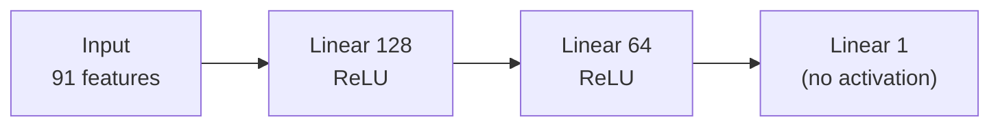
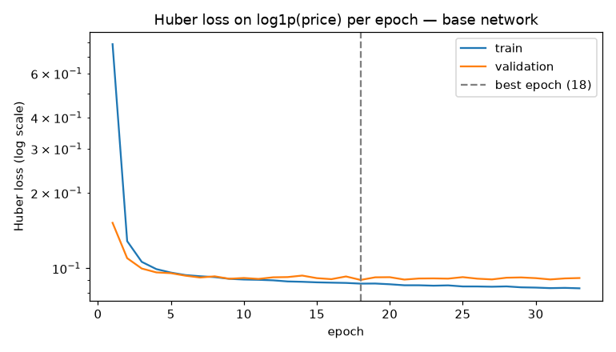

# 2. Regression — New York City Airbnb 2019

!!! info "Team"

    | Full name | GitHub |
    |-----------|--------|
    | Alex Chequer | [AlexChequer](https://github.com/AlexChequer) |
    | Lucas Ikawa | [Lucasikawa](https://github.com/Lucasikawa) |
    | Carlos Hernani Cardoso | [carloshernanic](https://github.com/carloshernanic) |

    Dataset, decisions and status: [project page](../index.md). Previous deliverable:
    [EDA](../eda/index.md).

**How to reproduce** (from the repository root, with `requirements.txt` installed):

```shell
python docs/projects/regression/code/baselines.py   # Stage 1: baselines_numbers.json
python docs/projects/regression/code/train.py       # Stages 2–3: Figures 1–2 and train_numbers.json
```

Every number in the text comes from these scripts. Seed 42 everywhere (split, weight
initialization and batch order).

## 0 · Starting point

**Pipeline.** The EDA pipeline is **imported, not copied**:
[`code/data.py`](https://github.com/AlexChequer/ann-dl-project/blob/main/docs/projects/regression/code/data.py)
imports `load_split`, `build_preprocessor` and `transform_target` from
[`docs/projects/eda/code/pipeline.py`](../eda/index.md#c-pipeline). Same dataset, same task
(regression on `price`), same 80/20 split with `random_state=42`, so the test set has the
same **9,777** listings as in the EDA.

??? example "code/data.py"

    ```python
    --8<-- "docs/projects/regression/code/data.py"
    ```

**What changed since the EDA, and why:**

| Change | Reason |
|--------|--------|
| A **validation set** is taken from the EDA training set: 20% of it, stratified by `log1p(price)` quintile (same rule as the train/test split), seed 42 | every choice in Stages 1–4 is made on validation, so the test set is used only once, in Stage 5 |
| The preprocessor is **fitted on the new, smaller training set** (31,285 rows), not on the 39,107 rows of the EDA | fitting on rows that are now validation would leak their statistics (p99 clips, scaler means, category frequencies) |
| The model sees **91 features instead of 102** | consequence of the line above: with fewer training rows, only 75 neighbourhoods (instead of 86) reach the 50-listing minimum; the others fall into `neighbourhood_infrequent_sklearn`. 91 = 7 numerical + 5 boroughs + 76 neighbourhood columns + 3 room types |
| The test set is only loaded with `load_data(with_test=True)` | prevents an accidental use of the test set before Stage 5 |

| Set | Rows | Mean price (US$) | Median price (US$) |
|-----|-----:|-----------------:|-------------------:|
| Train | **31,285** | 154.06 | 106 |
| Validation | **7,822** | 150.25 | 106 |
| Test | **9,777** | not looked at until Stage 5 | — |

There are 0 NaN after the pipeline in train and validation.

**Target.** The network predicts `log1p(price)` (EDA, Stage 1C: skewness 19.22 → 0.64).
Every metric below is computed **in US$**, after inverting with `expm1`.

**Main metric: MAE in US$**, on the original scale. Reasons: (1) it reads directly as "the
prediction is off by US$ X per night on average"; (2) the EDA showed a price tail up to
US$ 10,000, and RMSE and R² in US$ are dominated by those few listings, so they would mostly
measure the luxury tail and not the typical listing. RMSE and R² are still reported, as
required.

**Success criterion, set before training any network:** the network's **MAE on the test set
must be at least 5% lower than the MAE of the best baseline** on the same test set. Why 5%
and not more: the EDA found little signal (largest |ρ| with the target is 0.44) and the
strongest effects — room type and borough — are additive in log scale, which a linear model
already captures. What is left for the network is the nonlinear part: the price surface over
latitude × longitude and its interaction with room type (EDA, Figure 5).

## 1 · Baselines

Both baselines use **the same pipeline and the same target** as the network: fitted on
`log1p(price)` with the 91 features, predictions converted back to US$, evaluated on the
**validation** set.

- **Trivial:** `DummyRegressor(strategy="mean")` — predicts the training mean of
  `log1p(price)` for every listing.
- **Linear:** `Ridge(alpha=1.0)` — linear regression with L2, because the 76 one-hot
  neighbourhood columns are sparse and correlated with the borough columns.

??? example "code/baselines.py"

    ```python
    --8<-- "docs/projects/regression/code/baselines.py"
    ```

| Baseline (validation) | MAE (US$) | RMSE (US$) | R² (US$) | RMSE in log |
|-----------------------|----------:|-----------:|---------:|------------:|
| Dummy (mean) | 81.78 | 218.16 | −0.029 | 0.687 |
| **Ridge** | **57.85** | 200.96 | 0.127 | 0.458 |

**Reading.**

- Ridge cuts the MAE of the trivial baseline by **29.3%** (81.78 → 57.85): room type and
  location alone already explain a large part of the price, as the EDA suggested (Figure 6).
- In log scale Ridge is much better than its R² in US$ suggests: the RMSE in log drops from
  0.687 to 0.458, which is **55.5% of the variance of `log1p(price)` explained**
  (1 − 0.458² / 0.687²). The R² in US$ is only 0.127 because the squared error in US$ is
  dominated by the luxury tail, which no feature here explains. This confirms the choice of
  MAE as the main metric.
- The Dummy has a slightly negative R² in US$ (−0.029) because it predicts the mean of the
  log, which after `expm1` is below the arithmetic mean that R² uses as reference.
- **Best baseline: Ridge, MAE US$ 57.85 on validation.** This is the number the network has
  to beat.

## 2 · The network

MLP in **PyTorch**, in
[`code/model.py`](https://github.com/AlexChequer/ann-dl-project/blob/main/docs/projects/regression/code/model.py).



| | Choice | Why |
|---|--------|-----|
| Hidden layers | 2 | one hidden layer can already bend the linear solution; the second lets the network combine location with room type, the interaction the EDA pointed to. Other depths are tested in Stage 4 |
| Widths | 128 → 64 | first layer wider than the input (91) so that the sparse one-hot columns are not squeezed right away; then it narrows towards the single output |
| Activation | ReLU | cheap, does not saturate for positive inputs, standard for tabular MLPs |
| Initialization | He (Kaiming) normal, biases at 0 | designed for ReLU: keeps the variance of the activations stable from layer to layer |
| Output | 1 linear unit | regression: `log1p(price)` is an unbounded real number, so no activation |
| Loss | Huber (δ = 1) on `log1p(price)` | see below |

**Loss, justified by the EDA outliers.** Even after the log, the target keeps a right tail
(skewness 0.64; 2.17% of the EDA training listings cost more than US$ 500) that the features
do not explain. With MSE, those few listings would produce the largest gradients. Huber is
quadratic for errors below 1 log unit (a factor of about 2.7 in price) and linear above
that, so ordinary listings are treated as in MSE and the tail is treated as in MAE — which
also matches the main metric.

**Size.** The network has **20,097 parameters** (91·128 + 128 = 11,776; 128·64 + 64 = 8,256;
64 + 1 = 65) for **31,285 training rows** — 0.64 parameter per row. It has far more capacity
than Ridge (92 parameters) and could overfit, so early stopping (Stage 3) and regularization
(Stage 4) are needed, but it still has fewer parameters than training rows.

??? example "code/model.py"

    ```python
    --8<-- "docs/projects/regression/code/model.py"
    ```

## 3 · Training

The loop is `train_model` in
[`code/train.py`](https://github.com/AlexChequer/ann-dl-project/blob/main/docs/projects/regression/code/train.py);
Stages 4 and 5 reuse the same function.

| | Choice | Why |
|---|--------|-----|
| Optimizer | Adam (`AdamW` with `weight_decay=0`) | adapts the step per parameter, which matters here: the one-hot columns of rare neighbourhoods get a gradient in very few batches, while the 7 numerical features get one in every batch. Using `AdamW` lets Stage 4 turn on weight decay without changing the code |
| Learning rate | 1e-3 | compared with 1e-2 and 1e-4 below (Figure 2) |
| Batch size | 256 | 123 updates per epoch on 31,285 rows: enough updates to converge in few epochs, with batches large enough for a stable curve |
| Maximum epochs | 200 | only an upper limit; early stopping decides |
| Early stopping | patience 15 on the **validation loss**, best weights restored | the validation loss oscillates between epochs (Figure 1), so stopping at the first bad epoch would stop on noise; 15 epochs separates noise from a real upward trend |

??? example "code/train.py"

    ```python
    --8<-- "docs/projects/regression/code/train.py"
    ```


/// caption
**Figure 1** — Huber loss on `log1p(price)` per epoch, training and validation, base network
(no regularization; log-scale y axis). The dashed line marks the epoch with the best
validation loss.
///

**Reading Figure 1.**

- **It converges, and fast.** The training loss falls from 0.786 in epoch 1 to 0.099 in
  epoch 4; the validation loss goes from 0.152 to 0.096 in the same 4 epochs. After that the
  gains are in the third decimal place.
- **Best epoch: 18** (validation loss **0.0899**, training loss 0.0869). Training stopped at
  epoch **33**, after 15 epochs with no improvement, and the weights of epoch 18 were
  restored.
- **Overfitting starts right after epoch 18, and it is mild.** From epoch 18 to 33 the
  training loss keeps falling (0.0869 → 0.0832) while the validation loss rises
  (0.0899 → 0.0915): the gap between the curves grows from 0.003 to 0.008.
- The small gap says the base network is **not limited by overfitting**. Training and
  validation losses are almost the same, so what limits the model is the information in the
  features (the EDA already expected a high error), not the capacity of the network.


/// caption
**Figure 2** — Validation loss per epoch for three learning rates (same network, same seed;
log-scale y axis).
///

| Learning rate | Best epoch | Stopped at | Best validation loss | Validation MAE (US$) |
|--------------:|-----------:|-----------:|---------------------:|---------------------:|
| 1e-2 | 23 | 38 | 0.0910 | 55.91 |
| **1e-3** | **18** | **33** | 0.0899 | **55.57** |
| 1e-4 | 129 | 144 | 0.0890 | 55.80 |

**Reading Figure 2.** With 1e-2 the validation loss is noisy — after epoch 5 it still jumps
between 0.091 and 0.110, while with 1e-3 it stays between 0.090 and 0.094 — and its best
value is the worst of the three (0.0910). With 1e-4 the curve is smooth and reaches the lowest loss
(0.0890), but it needs **129 epochs** — 7 times more than 1e-3 — and its MAE in US$ is not
better (55.80 against 55.57). **1e-3** gives the best MAE for a fraction of the cost, so it
is the base value; the learning rate is searched again in Stage 4 together with
regularization.

**Base network against the baselines (validation):**

| Model | MAE (US$) | RMSE (US$) | R² (US$) | RMSE in log |
|-------|----------:|-----------:|---------:|------------:|
| Dummy (mean) | 81.78 | 218.16 | −0.029 | 0.687 |
| Ridge | 57.85 | 200.96 | 0.127 | 0.458 |
| **MLP, base** | **55.57** | 198.30 | 0.149 | 0.440 |

The base network has a validation MAE **3.9% lower** than Ridge (57.85 → 55.57). On the
training set its MAE is 57.37 — higher than on validation because the training set holds
more of the extreme listings (training RMSE 235.24 against 198.30), not because of
underfitting on validation. The 3.9% is **below the 5% criterion** of Stage 0: the base
network alone would not meet it. Whether the final network meets it is decided on the test
set, in Stage 5.

## 4 · Regularization and hyperparameters

<!-- ALEX. Two or more techniques (weight decay, dropout, BatchNorm) each compared with the
base network of Stage 3 (validation MAE 55.57). Search of 8+ configurations chosen BY
VALIDATION, in a table sorted by validation MAE. Script: code/search.py, writes
code/search_numbers.json and code/best_config.json. -->

## 5 · Test evaluation

<!-- ALEX. Chosen configuration retrained and evaluated ONCE on the test set: MAE, RMSE, R²
in US$. Table with the network, Dummy and Ridge on the same test set. Was the Stage 0
criterion (MAE at least 5% below the best baseline) met? 3+ seeds (mean ± std). Mandatory
figures: predicted × actual and residuals × predicted. Script: code/evaluate.py, writes
code/test_numbers.json and code/test_predictions.csv. -->

## 6 · Error analysis

<!-- LUCAS. Error by subgroup (room_type, neighbourhood_group, price ranges) and worst
examples, with one hypothesis per pattern. Permutation importance: does it confirm the EDA?
Script: code/error_analysis.py, reads code/test_predictions.csv. -->

## 7 · Conclusion

<!-- LUCAS. Was the network worth it? Limitations, who is affected by an error, what we
would do with more time. -->

## Results summary

| # | Summary | Value |
|---|---------|-------|
| 1 | Dataset, task, target and main metric | NYC Airbnb 2019 · regression · `price` (modeled as `log1p(price)`) · MAE in US$ |
| 2 | Train · validation · test (rows) | 31,285 · 7,822 · 9,777 |
| 3 | Best baseline and its test metric | <!-- ALEX --> |
| 4 | Chosen network: layers × units, number of parameters, regularization | <!-- ALEX --> |
| 5 | Optimizer, learning rate, batch and the epoch it stopped at | <!-- ALEX --> |
| 6 | The network's main metric on the test set (mean ± std, 3 seeds) | <!-- ALEX --> |
| 7 | Success criterion met? | <!-- ALEX --> |
| 8 | Subgroup with the largest error and its value | <!-- LUCAS --> |
