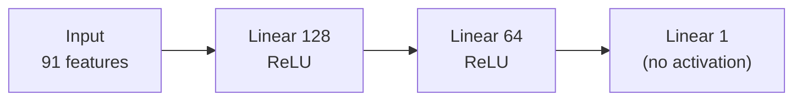
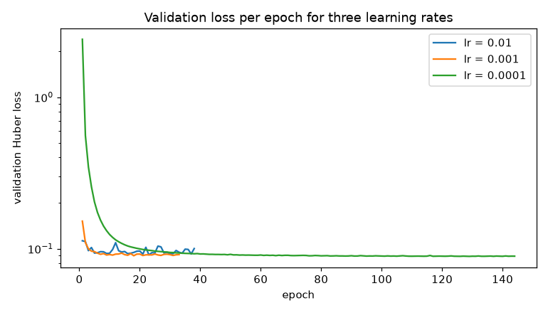
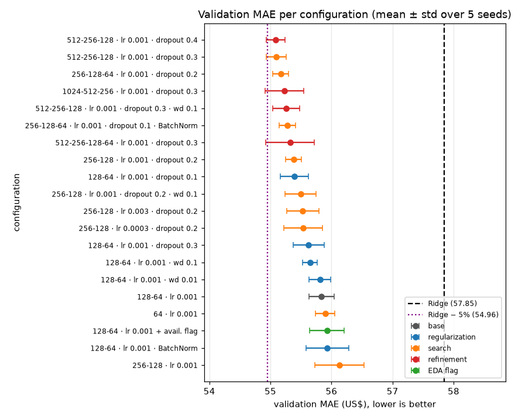
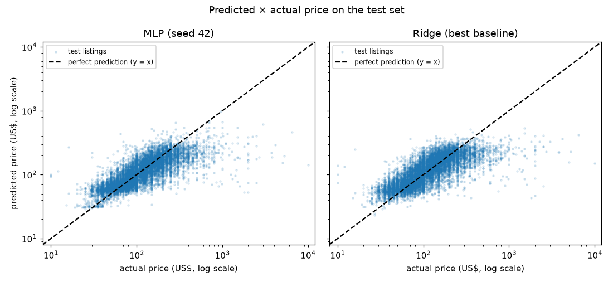
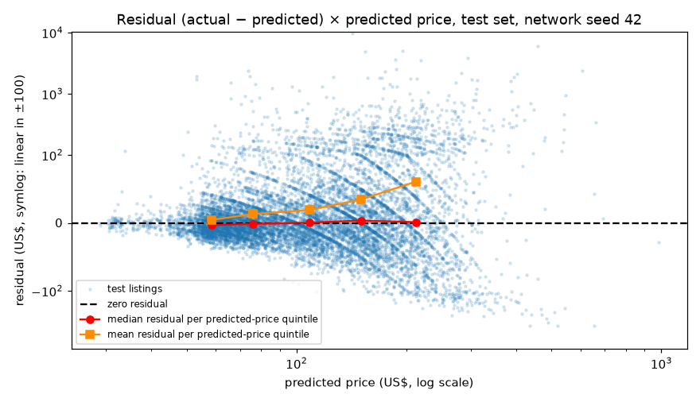
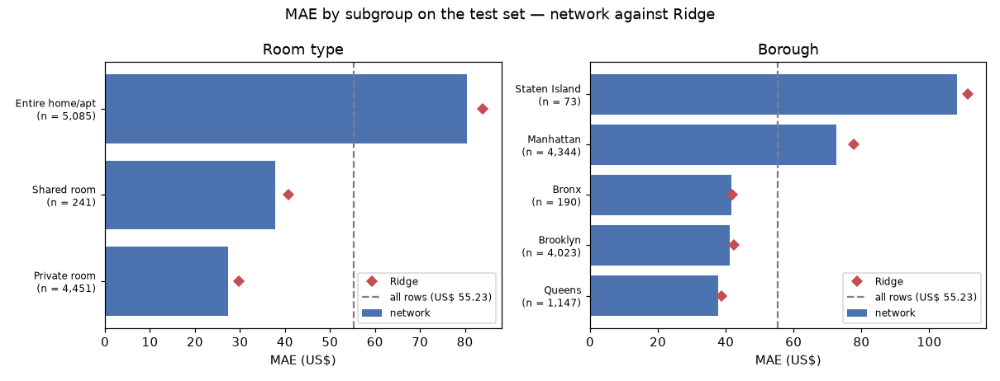

# 2. Regression — New York City Airbnb 2019

!!! info "Team"

    | Full name | GitHub |
    |-----------|--------|
    | Alex Chequer | [AlexChequer](https://github.com/AlexChequer) |
    | Lucas Ikawa | [Lucasikawa](https://github.com/Lucasikawa) |
    | Carlos Hernani Cardoso | [carloshernanic](https://github.com/carloshernanic) |

    Dataset, decisions and status: [project page](../index.md). Previous deliverable:
    [EDA](../eda/index.md).

**How to reproduce** (from the repository root, with `requirements.txt` installed):

```shell
python docs/projects/regression/code/baselines.py   # Stage 1: baselines_numbers.json
python docs/projects/regression/code/train.py       # Stages 2–3: Figures 1–2 and train_numbers.json
python docs/projects/regression/code/search.py      # Stage 4: Figure 3, search_numbers.json, best_config.json
python docs/projects/regression/code/evaluate.py    # Stage 5, development run on validation (writes nothing)
python docs/projects/regression/code/evaluate.py --split test  # Stage 5: the test run — Figures 4–5,
                                                               # test_numbers.json, test_predictions.csv
python docs/projects/regression/code/error_analysis.py  # Stage 6: Figures 6–8 and error_numbers.json
```

Every number in the text comes from these scripts. Seed 42 everywhere (split, weight
initialization and batch order); Stages 4 and 5 repeat every training with seeds 42 to 46,
on the same split.

## 0 · Starting point

**Pipeline.** The EDA pipeline is **imported, not copied**:
[`code/data.py`](https://github.com/AlexChequer/ann-dl-project/blob/main/docs/projects/regression/code/data.py)
imports `load_split`, `build_preprocessor` and `transform_target` from
[`docs/projects/eda/code/pipeline.py`](../eda/index.md#c-pipeline). Same dataset, same task
(regression on `price`), same 80/20 split with `random_state=42`, so the test set has the
same **9,777** listings as in the EDA.

??? example "code/data.py"

    ```python
    --8<-- "docs/projects/regression/code/data.py"
    ```

**What changed since the EDA, and why:**

| Change | Reason |
|--------|--------|
| A **validation set** is taken from the EDA training set: 20% of it, stratified by `log1p(price)` quintile (same rule as the train/test split), seed 42 | every choice in Stages 1–4 is made on validation, so the test set is used only once, in Stage 5 |
| The preprocessor is **fitted on the new, smaller training set** (31,285 rows), not on the 39,107 rows of the EDA | fitting on rows that are now validation would leak their statistics (p99 clips, scaler means, category frequencies) |
| The model sees **91 features instead of 102** | consequence of the line above: with fewer training rows, only 75 neighbourhoods (instead of 86) reach the 50-listing minimum; the others fall into `neighbourhood_infrequent_sklearn`. 91 = 7 numerical + 5 boroughs + 76 neighbourhood columns + 3 room types |
| The test set is only loaded with `load_data(with_test=True)` | prevents an accidental use of the test set before Stage 5 |

| Set | Rows | Mean price (US$) | Median price (US$) |
|-----|-----:|-----------------:|-------------------:|
| Train | **31,285** | 154.06 | 106 |
| Validation | **7,822** | 150.25 | 106 |
| Test | **9,777** | not looked at until Stage 5 | — |

There are 0 NaN after the pipeline in train and validation.

**Target.** The network predicts `log1p(price)` (EDA, Stage 1C: skewness 19.22 → 0.64).
Every metric below is computed **in US$**, after inverting with `expm1`.

**Main metric: MAE in US$**, on the original scale. Reasons: (1) it reads directly as "the
prediction is off by US$ X per night on average"; (2) the EDA showed a price tail up to
US$ 10,000, and RMSE and R² in US$ are dominated by those few listings, so they would mostly
measure the luxury tail and not the typical listing. RMSE and R² are still reported, as
required.

**Success criterion, set before training any network:** the network's **MAE on the test set
must be at least 5% lower than the MAE of the best baseline** on the same test set. Why 5%
and not more: the EDA found little signal (largest |ρ| with the target is 0.44) and the
strongest effects — room type and borough — are additive in log scale, which a linear model
already captures. What is left for the network is the nonlinear part: the price surface over
latitude × longitude and its interaction with room type (EDA, Figure 5).

## 1 · Baselines

Both baselines use **the same pipeline and the same target** as the network: fitted on
`log1p(price)` with the 91 features, predictions converted back to US$, evaluated on the
**validation** set.

- **Trivial:** `DummyRegressor(strategy="mean")` — predicts the training mean of
  `log1p(price)` for every listing.
- **Linear:** `Ridge(alpha=1.0)` — linear regression with L2, because the 76 one-hot
  neighbourhood columns are sparse and correlated with the borough columns.

??? example "code/baselines.py"

    ```python
    --8<-- "docs/projects/regression/code/baselines.py"
    ```

| Baseline (validation) | MAE (US$) | RMSE (US$) | R² (US$) | RMSE in log |
|-----------------------|----------:|-----------:|---------:|------------:|
| Dummy (mean) | 81.78 | 218.16 | −0.029 | 0.687 |
| **Ridge** | **57.85** | 200.96 | 0.127 | 0.458 |

**Reading.**

- Ridge cuts the MAE of the trivial baseline by **29.3%** (81.78 → 57.85): room type and
  location alone already explain a large part of the price, as the EDA suggested (Figure 6).
- In log scale Ridge is much better than its R² in US$ suggests: the RMSE in log drops from
  0.687 to 0.458, which is **55.5% of the variance of `log1p(price)` explained**
  (1 − 0.458² / 0.687²). The R² in US$ is only 0.127 because the squared error in US$ is
  dominated by the luxury tail, which no feature here explains. This confirms the choice of
  MAE as the main metric.
- The Dummy has a slightly negative R² in US$ (−0.029) because it predicts the mean of the
  log, which after `expm1` is below the arithmetic mean that R² uses as reference.
- **Best baseline: Ridge, MAE US$ 57.85 on validation.** This is the number the network has
  to beat.

## 2 · The network

MLP in **PyTorch**, in
[`code/model.py`](https://github.com/AlexChequer/ann-dl-project/blob/main/docs/projects/regression/code/model.py).



| | Choice | Why |
|---|--------|-----|
| Hidden layers | 2 | one hidden layer can already bend the linear solution; the second lets the network combine location with room type, the interaction the EDA pointed to. Other depths are tested in Stage 4 |
| Widths | 128 → 64 | first layer wider than the input (91) so that the sparse one-hot columns are not squeezed right away; then it narrows towards the single output |
| Activation | ReLU | cheap, does not saturate for positive inputs, standard for tabular MLPs |
| Initialization | He (Kaiming) normal, biases at 0 | designed for ReLU: keeps the variance of the activations stable from layer to layer |
| Output | 1 linear unit | regression: `log1p(price)` is an unbounded real number, so no activation |
| Loss | Huber (δ = 1) on `log1p(price)` | see below |

**Loss, justified by the EDA outliers.** Even after the log, the target keeps a right tail
(skewness 0.64; 2.17% of the EDA training listings cost more than US$ 500) that the features
do not explain. With MSE, those few listings would produce the largest gradients. Huber is
quadratic for errors below 1 log unit (a factor of about 2.7 in price) and linear above
that, so ordinary listings are treated as in MSE and the tail is treated as in MAE — which
also matches the main metric.

**Size.** The network has **20,097 parameters** (91·128 + 128 = 11,776; 128·64 + 64 = 8,256;
64 + 1 = 65) for **31,285 training rows** — 0.64 parameter per row. It has far more capacity
than Ridge (92 parameters) and could overfit, so early stopping (Stage 3) and regularization
(Stage 4) are needed, but it still has fewer parameters than training rows.

??? example "code/model.py"

    ```python
    --8<-- "docs/projects/regression/code/model.py"
    ```

## 3 · Training

The loop is `train_model` in
[`code/train.py`](https://github.com/AlexChequer/ann-dl-project/blob/main/docs/projects/regression/code/train.py);
Stages 4 and 5 reuse the same function.

| | Choice | Why |
|---|--------|-----|
| Optimizer | Adam (`AdamW` with `weight_decay=0`) | adapts the step per parameter, which matters here: the one-hot columns of rare neighbourhoods get a gradient in very few batches, while the 7 numerical features get one in every batch. Using `AdamW` lets Stage 4 turn on weight decay without changing the code |
| Learning rate | 1e-3 | compared with 1e-2 and 1e-4 below (Figure 2) |
| Batch size | 256 | 123 updates per epoch on 31,285 rows: enough updates to converge in few epochs, with batches large enough for a stable curve |
| Maximum epochs | 200 | only an upper limit; early stopping decides |
| Early stopping | patience 15 on the **validation loss**, best weights restored | the validation loss oscillates between epochs (Figure 1), so stopping at the first bad epoch would stop on noise; 15 epochs separates noise from a real upward trend |

??? example "code/train.py"

    ```python
    --8<-- "docs/projects/regression/code/train.py"
    ```


/// caption
**Figure 1** — Huber loss on `log1p(price)` per epoch, training and validation, base network
(no regularization; log-scale y axis). The dashed line marks the epoch with the best
validation loss.
///

**Reading Figure 1.**

- **It converges, and fast.** The training loss falls from 0.786 in epoch 1 to 0.099 in
  epoch 4; the validation loss goes from 0.152 to 0.096 in the same 4 epochs. After that the
  gains are in the third decimal place.
- **Best epoch: 18** (validation loss **0.0899**, training loss 0.0869). Training stopped at
  epoch **33**, after 15 epochs with no improvement, and the weights of epoch 18 were
  restored.
- **Overfitting starts right after epoch 18, and it is mild.** From epoch 18 to 33 the
  training loss keeps falling (0.0869 → 0.0832) while the validation loss rises
  (0.0899 → 0.0915): the gap between the curves grows from 0.003 to 0.008.
- The small gap says the base network is **not limited by overfitting**. Training and
  validation losses are almost the same, so what limits the model is the information in the
  features (the EDA already expected a high error), not the capacity of the network.


/// caption
**Figure 2** — Validation loss per epoch for three learning rates (same network, same seed;
log-scale y axis).
///

| Learning rate | Best epoch | Stopped at | Best validation loss | Validation MAE (US$) |
|--------------:|-----------:|-----------:|---------------------:|---------------------:|
| 1e-2 | 23 | 38 | 0.0910 | 55.91 |
| **1e-3** | **18** | **33** | 0.0899 | **55.57** |
| 1e-4 | 129 | 144 | 0.0890 | 55.80 |

**Reading Figure 2.** With 1e-2 the validation loss is noisy — after epoch 5 it still jumps
between 0.091 and 0.110, while with 1e-3 it stays between 0.090 and 0.094 — and its best
value is the worst of the three (0.0910). With 1e-4 the curve is smooth and reaches the lowest loss
(0.0890), but it needs **129 epochs** — 7 times more than 1e-3 — and its MAE in US$ is not
better (55.80 against 55.57). **1e-3** gives the best MAE for a fraction of the cost, so it
is the base value; the learning rate is searched again in Stage 4 together with
regularization.

**Base network against the baselines (validation):**

| Model | MAE (US$) | RMSE (US$) | R² (US$) | RMSE in log |
|-------|----------:|-----------:|---------:|------------:|
| Dummy (mean) | 81.78 | 218.16 | −0.029 | 0.687 |
| Ridge | 57.85 | 200.96 | 0.127 | 0.458 |
| **MLP, base** | **55.57** | 198.30 | 0.149 | 0.440 |

The base network has a validation MAE **3.9% lower** than Ridge (57.85 → 55.57). On the
training set its MAE is 57.37 — higher than on validation because the training set holds
more of the extreme listings (training RMSE 235.24 against 198.30), not because of
underfitting on validation. The 3.9% is **below the 5% criterion** of Stage 0: the base
network alone would not meet it. Whether the final network meets it is decided on the test
set, in Stage 5.

## 4 · Regularization and hyperparameters

Everything in this stage uses **train and validation only**:
[`code/search.py`](https://github.com/AlexChequer/ann-dl-project/blob/main/docs/projects/regression/code/search.py)
calls `load_data()` without the test set and trains every configuration with `train_model`
from Stage 3 (same Huber loss, batch 256, early stopping with patience 15).

**Five seeds per configuration, not one.** Stage 3 used a single seed. Repeating the base
network with seeds 42 to 46 (the seed changes weight initialization and batch order; the
split stays fixed) gives a validation MAE of **55.84 ± 0.21** (mean ± sample standard
deviation). Most of the differences between configurations below are of a few tenths of a
dollar — the same order as this standard deviation — so a single seed would rank noise.
Every configuration is therefore trained 5 times and ranked by its **mean validation MAE**.
(With seed 42 alone the base network gives 55.55 here against 55.57 in Stage 3, with the
same best and stopping epochs, 18 and 33: the difference is floating-point arithmetic across
machines.)

??? example "code/search.py"

    ```python
    --8<-- "docs/projects/regression/code/search.py"
    ```

### 4A · Each regularization technique alone

Same base network (128 → 64, learning rate 1e-3); **one change at a time**, two strengths
for weight decay and for dropout:

| Technique | Setting | Validation MAE (US$) | Δ vs base | Mean best epoch |
|-----------|---------|---------------------:|----------:|----------------:|
| None (base) | — | 55.84 ± 0.21 | — | 25.2 |
| Weight decay (AdamW) | 0.01 | 55.81 ± 0.18 | −0.02 | 25.2 |
| Weight decay (AdamW) | 0.1 | 55.65 ± 0.12 | −0.19 | 28.0 |
| **Dropout** | **0.1** | **55.39 ± 0.23** | **−0.44** | 65.2 |
| Dropout | 0.3 | 55.63 ± 0.25 | −0.21 | 96.6 |
| BatchNorm | after each linear layer | 55.93 ± 0.35 | +0.10 | 24.4 |

Why these settings: in `AdamW` the decay is decoupled from the gradient, and each step
shrinks the weights by a factor of `lr × weight_decay` (1e-5 or 1e-4 per step here), so
0.01 and 0.1 go from weak to moderate. Dropout 0.1 and 0.3 bracket the usual range for a
network this narrow (64 units in the last hidden layer).

**Reading.**

- **Dropout is the only technique with a clear effect on its own**: 0.1 lowers the MAE by
  0.44, about twice the seed standard deviation. It also makes training longer (best epoch
  65.2 against 25.2): the noise it injects slows down the fit to the training set, and the
  validation loss keeps improving for more epochs.
- **More dropout is worse on this small network** (0.3: −0.21 only): removing 30% of 64
  units takes away capacity the network needs. Section 4C shows that the same 0.3 works
  well once the network is wider.
- **Weight decay barely matters**: 0.01 changes the MAE by 0.02 (a tenth of the seed
  standard deviation); 0.1 lowers it by 0.19, still within the noise.
- **BatchNorm makes it slightly worse** (+0.10) and is the least stable of the six (std
  0.35). The pipeline already standardizes every input and the network has only two hidden
  layers, so there is no conditioning problem for BatchNorm to fix; what it adds is noise
  from the batch statistics.
- This agrees with Stage 3: the base network was **not limited by overfitting** (small gap
  between the training and validation curves), so regularizing it changes little. Where
  regularization matters is when the capacity grows: the 256 → 128 network without
  regularization is the **worst** of all configurations below (56.13 ± 0.40; it peaks at
  epoch 19.0), and with dropout 0.2 the same network drops to 55.38 ± 0.13.

### 4B · The `availability_365 == 0` flag promised in the EDA

The EDA found that 35.9% of the listings have `availability_365 == 0` and proposed testing a
binary flag for them. Here the flag is appended as a 92nd column (`add_availability_flag`);
it is 1 for **36.0%** of the training rows.

| Model (validation) | Without the flag | With the flag | Δ MAE |
|--------------------|-----------------:|--------------:|------:|
| Base network (5 seeds) | 55.84 ± 0.21 | 55.93 ± 0.28 | +0.09 |
| Ridge | 57.85 | 57.65 | −0.19 |

**It does not help the network** (+0.09, inside the seed standard deviation), so it is
**not used**. A plausible reason: `availability_365` is already an input, standardized, and
0 is its minimum value, so a single ReLU unit can already isolate the listings at 0. Ridge
cannot build that step on its own and gains 0.19. The baselines stay exactly as defined in
Stage 1; with the flag, Ridge would be 0.19 better, which would only make the 5% criterion
harder to meet.

### 4C · Search

**What varies:** learning rate (3e-4, 1e-3, 3e-3), width and depth (from one layer of 64 up to
1024 → 512 → 256 and four hidden layers), and regularization (dropout 0 to 0.4, weight decay
0.1, BatchNorm). **What stays fixed:** Huber loss, `AdamW`, batch 256, early stopping with
patience 15, at most 200 epochs. **Selection rule, fixed before running:** the lowest mean
validation MAE over the 5 seeds.

The search ran in **two rounds**, both on validation:

- **Round 1** (9 configurations), designed after 4A: wider and deeper networks combined with
  dropout, the learning rate around the best of them, and BatchNorm and weight decay as
  add-ons.
- **Round 2** (4 configurations): the best of round 1 was the widest and most regularized
  network of the grid (512 → 256 → 128, dropout 0.3) — at its edge — so the search went on
  in that direction: more dropout, weight decay on top, one more layer, double the width.

Together with the 6 configurations of 4A, **19 configurations** are ranked, each trained
with 5 seeds (95 trainings). The flag of 4B is shown at the end, outside the ranking.

| # | Configuration (hidden units · lr · regularization) | Origin | Parameters | Validation MAE (US$) | RMSE (US$) | R² (US$) | Mean best epoch |
|--:|-----------------------------------------------------|--------|-----------:|---------------------:|-----------:|---------:|----------------:|
| 1 | **512-256-128 · lr 0.001 · dropout 0.4** | round 2 | 211,457 | **55.09 ± 0.15** | 198.89 | 0.144 | 64.6 |
| 2 | 512-256-128 · lr 0.001 · dropout 0.3 | round 1 | 211,457 | 55.09 ± 0.16 | 198.53 | 0.147 | 56.6 |
| 3 | 256-128-64 · lr 0.001 · dropout 0.2 | round 1 | 64,769 | 55.17 ± 0.13 | 199.11 | 0.143 | 47.8 |
| 4 | 1024-512-256 · lr 0.001 · dropout 0.3 | round 2 | 750,593 | 55.23 ± 0.32 | 198.94 | 0.144 | 46.0 |
| 5 | 512-256-128 · lr 0.001 · dropout 0.3 · wd 0.1 | round 2 | 211,457 | 55.26 ± 0.22 | 198.01 | 0.152 | 47.8 |
| 6 | 256-128-64 · lr 0.001 · dropout 0.1 · BatchNorm | round 1 | 65,665 | 55.28 ± 0.14 | 197.81 | 0.154 | 53.6 |
| 7 | 512-256-128-64 · lr 0.001 · dropout 0.3 | round 2 | 219,649 | 55.32 ± 0.40 | 199.60 | 0.138 | 44.2 |
| 8 | 256-128 · lr 0.001 · dropout 0.2 | round 1 | 56,577 | 55.38 ± 0.13 | 197.81 | 0.154 | 82.4 |
| 9 | 128-64 · lr 0.001 · dropout 0.1 | 4A | 20,097 | 55.39 ± 0.23 | 198.63 | 0.147 | 65.2 |
| 10 | 256-128 · lr 0.001 · dropout 0.2 · wd 0.1 | round 1 | 56,577 | 55.50 ± 0.25 | 198.72 | 0.146 | 51.0 |
| 11 | 256-128 · lr 0.003 · dropout 0.2 | round 1 | 56,577 | 55.53 ± 0.26 | 198.61 | 0.147 | 38.2 |
| 12 | 256-128 · lr 0.0003 · dropout 0.2 | round 1 | 56,577 | 55.54 ± 0.32 | 198.99 | 0.144 | 74.0 |
| 13 | 128-64 · lr 0.001 · dropout 0.3 | 4A | 20,097 | 55.63 ± 0.25 | 198.54 | 0.147 | 96.6 |
| 14 | 128-64 · lr 0.001 · wd 0.1 | 4A | 20,097 | 55.65 ± 0.12 | 198.30 | 0.149 | 28.0 |
| 15 | 128-64 · lr 0.001 · wd 0.01 | 4A | 20,097 | 55.81 ± 0.18 | 198.10 | 0.151 | 25.2 |
| 16 | 128-64 · lr 0.001 (base) | base | 20,097 | 55.84 ± 0.21 | 198.03 | 0.152 | 25.2 |
| 17 | 64 · lr 0.001 | round 1 | 5,953 | 55.90 ± 0.16 | 198.41 | 0.149 | 49.8 |
| 18 | 128-64 · lr 0.001 · BatchNorm | 4A | 20,481 | 55.93 ± 0.35 | 198.66 | 0.146 | 24.4 |
| 19 | 256-128 · lr 0.001 | round 1 | 56,577 | 56.13 ± 0.40 | 198.05 | 0.152 | 19.0 |
| — | 128-64 · lr 0.001 + `availability_365 == 0` flag | 4B | 20,225 | 55.93 ± 0.28 | 198.42 | 0.149 | 25.0 |


/// caption
**Figure 3** — Validation MAE (US$) of every configuration, mean ± standard deviation over
5 seeds, sorted from best (top) to worst. Colors mark where each configuration comes from.
Dashed line: Ridge on validation (57.85); dotted line: 5% below Ridge (54.96), the margin
the Stage 0 criterion asks for on the test set.
///

**Reading Figure 3 and the table.**

- **What wins is capacity *with* regularization.** The top 3 all have 3 hidden layers and
  dropout of 0.2 or more. Without regularization, more width hurts: 256 → 128 alone is last
  (56.13), and the same network with dropout 0.2 is eighth (55.38).
- **The learning rate of Stage 3 holds.** Around 256 → 128 with dropout 0.2, both 3e-3
  (55.53) and 3e-4 (55.54) are worse than 1e-3 (55.38).
- **Round 2 found a plateau, which is why the search stops there.** Going from dropout 0.3
  to 0.4 changes nothing (55.09 and 55.09). Doubling the width (55.23) or adding a fourth
  layer (55.32) does not help and makes the result less stable (std 0.32 and 0.40).
- **The choice is a tie.** By the rule, dropout 0.4 is first (55.086 against 55.095, see
  `search_numbers.json`), but the gap is about 0.01 for a standard deviation of 0.15. The
  two are equivalent and the rule decides.
- **Gain over the base network: US$ 0.75** (55.84 → 55.09). The chosen network has 211,457
  parameters for 31,285 training rows — more parameters than rows; dropout 0.4 and early
  stopping are what keep it from memorizing the training set.
- **Already on validation, the margin is short of 5%:** the chosen network is **4.77% below
  Ridge** (57.85 → 55.09), to the left of the dashed line but not of the dotted one. Before
  opening the test set, the expectation was therefore a borderline result.

**Chosen configuration**, saved in `code/best_config.json` with only the keys that change
with respect to `BASE_CONFIG`:

```json
{"hidden": [512, 256, 128], "dropout": 0.4}
```

That is, **3 hidden layers of 512 → 256 → 128 units** (ReLU, He initialization), **dropout
0.4** after each hidden layer, no weight decay, no BatchNorm; `AdamW` with learning rate
1e-3, batch 256, Huber loss, early stopping with patience 15.

## 5 · Test evaluation

Script:
[`code/evaluate.py`](https://github.com/AlexChequer/ann-dl-project/blob/main/docs/projects/regression/code/evaluate.py).

**How the test set was used — once.**

1. Everything was fixed **before** the test set was loaded: the configuration
   (`best_config.json`, Stage 4), the seeds (42 to 46), the metrics, the figures and the
   decision rule for the criterion (**mean test MAE over the 5 seeds** against the best
   baseline's test MAE).
2. The script was developed on validation: without arguments, `evaluate.py` runs the whole
   evaluation on the validation set and writes nothing. That run reproduced Stage 4 exactly
   (55.09 ± 0.15), which confirms that retraining is deterministic. The figure and CSV code
   was also checked on validation predictions.
3. Then the script ran **once** with `--split test` — the only time Stages 0 to 5 loaded
   the test set (`load_data(with_test=True)`). **Nothing was changed after it** — no
   configuration, seed, threshold or figure choice was influenced by the test set. Running
   the command again reproduces the same numbers; it is not a new decision.

**Protocol.** For each seed, the chosen network is trained from scratch on the **31,285
training rows**, with early stopping on validation — the same protocol under which it was
selected. It is not retrained on train + validation, because early stopping needs the
validation set and the number of epochs would otherwise have to be guessed. Dummy and Ridge
are refitted on the same training rows with their Stage 1 settings. All models are evaluated
on the same **9,777 test listings**.

??? example "code/evaluate.py"

    ```python
    --8<-- "docs/projects/regression/code/evaluate.py"
    ```

| Model (test set, 9,777 rows) | MAE (US$) | RMSE (US$) | R² (US$) | RMSE in log |
|------------------------------|----------:|-----------:|---------:|------------:|
| Dummy (mean) | 82.12 | 222.21 | −0.029 | 0.685 |
| Ridge (best baseline) | 58.13 | 203.52 | 0.137 | 0.453 |
| **MLP 512-256-128, dropout 0.4** (5 seeds) | **55.28 ± 0.08** | 202.18 ± 0.62 | 0.148 ± 0.005 | 0.436 ± 0.001 |

| Seed | Test MAE (US$) | Below Ridge | Best epoch | Stopped at |
|-----:|---------------:|------------:|-----------:|-----------:|
| 42 | 55.23 | 4.99% | 69 | 84 |
| 43 | 55.38 | 4.74% | 73 | 88 |
| 44 | 55.36 | 4.77% | 74 | 89 |
| 45 | 55.26 | 4.94% | 59 | 74 |
| 46 | 55.19 | 5.06% | 48 | 63 |

**Was the Stage 0 criterion met? No.** The criterion asks for a test MAE at least 5% below
the best baseline: 0.95 × 58.13 = **US$ 55.22**. The network's mean test MAE is **55.28**,
**4.90%** below Ridge — US$ 0.06 short of the threshold. Only one seed of the five (46,
5.06%) passes on its own; picking it would mean choosing a seed by looking at the test set,
so the decision stays on the mean, as fixed in advance. The criterion is not changed.

**Is the gap to Ridge larger than the variation between seeds? Yes, by far.** The network
is **US$ 2.85** better than Ridge in mean MAE, and the standard deviation across seeds is
**US$ 0.08** — the gap is **34.6 times** the seed variation, and every one of the 5 seeds
beats Ridge (the worst seed has 55.38 against 58.13). So the improvement is real with
respect to training randomness; it is only smaller than the 5% we had asked for. The seed
standard deviation measures only training randomness, not which listings happened to fall
in the test set.

**Validation and test agree.** On validation the chosen network was 4.77% below Ridge; on
test it is 4.90%. Selecting 1 configuration out of 19 on validation did not produce an
optimistic validation number that collapsed on test.

**RMSE and R² tell a smaller story than MAE.** In RMSE the network gains little over Ridge
(202.18 against 203.52) and R² in US$ stays low (0.148 against 0.137). Both are dominated by
the luxury tail, as anticipated in Stage 0: the gain of the network is in the typical
listing, which is what MAE measures. In log scale the gain is clearer (RMSE 0.436 against
0.453).

**Output for Stage 6.** `code/test_predictions.csv` has one row per test listing:
`row_index` (row of `data/AB_NYC_2019.csv`, 0-based, to join with the raw features),
`price_true`, `price_pred` (network, seed 42), `pred_ridge` and `pred_dummy`, all in US$.
`code/test_numbers.json` holds every number of this section.


/// caption
**Figure 4** — Predicted × actual price on the test set (both axes in log scale), for the
network (seed 42, left) and for Ridge (right). Each point is a listing; the dashed line is a
perfect prediction.
///

**Reading Figure 4.**

- Both clouds are **flatter than the diagonal**: cheap listings are overpredicted and
  expensive ones underpredicted. That is what a model does when the features explain only
  part of the price — it pulls predictions towards the middle.
- Listings priced between US$ 1,000 and US$ 10,000 are predicted at a few hundred dollars by
  **both** models. The EDA had already found that no feature identifies them, so neither
  model can.
- The network's cloud reaches higher predictions than Ridge's (its highest test prediction is
  US$ 984.94): it can combine location and room type nonlinearly, while Ridge only adds
  their effects in log scale.


/// caption
**Figure 5** — Residual (actual − predicted price, US$) × predicted price, test set, network
with seed 42. The y axis is linear between −100 and +100 and logarithmic beyond; the x axis
is logarithmic. Red: median residual per quintile of the predicted price; orange: mean
residual per quintile.
///

**Reading Figure 5.**

- **The network is unbiased for the typical listing.** The median residual per predicted
  quintile stays between **−2.98 and +3.59 US$**, and the overall median residual is
  **−1.00 US$**, with **48.9%** of the listings underpredicted. That is the expected
  behaviour of a model trained on `log1p(price)`: back on the US$ scale, its prediction
  behaves like a conditional median, which is what minimizes MAE.
- **The mean tells a different story:** the mean residual is **+26.39 US$**, and per quintile
  it grows from **+4.43** (cheapest predictions, up to US$ 66.16) to **+60.82** (most
  expensive, above US$ 174.71). A few listings far above their prediction pull the mean up —
  the same luxury tail that keeps RMSE and R² low.
- **The error grows with the predicted price** (the cloud opens to the right): the model is
  less certain in absolute dollars where prices are higher.
- The diagonal stripes are listings with **round prices** (US$ 100, 150, 200...): for a
  fixed actual price, the residual falls linearly as the prediction rises.

## 6 · Error analysis

This section reads the **test** predictions Stage 5 wrote
([`code/test_predictions.csv`](https://github.com/AlexChequer/ann-dl-project/blob/main/docs/projects/regression/code/test_predictions.csv),
seed 42): MAE **US$ 55.23** against Ridge's **US$ 58.13** on the same 9,777 rows. No new
prediction is made on the test set here.

The permutation importance is the one exception: shuffling ten columns five times each is a
repeated probe, not a single evaluation, so it runs on the **validation** set, with the
chosen configuration retrained at seed 42 (validation MAE US$ 55.20).

Every subgroup is also measured against **Ridge** on the same rows — "the network errs more
here" only means something next to what the best baseline does with the same listings.
**Bias** is the mean of (prediction − true price): negative means the network asks for less
than the listing charges.

??? example "code/error_analysis.py"

    ```python
    --8<-- "docs/projects/regression/code/error_analysis.py"
    ```

### A. Error by subgroup

| `room_type` | Rows | MAE (US$) | Ridge (US$) | Gain | Mean price | MAE / price | Bias (US$) |
|-------------|-----:|----------:|------------:|-----:|-----------:|------------:|-----------:|
| Entire home/apt | 5,085 | 80.49 | 83.87 | 4.0% | 210.30 | 38.3% | −41.63 |
| Private room | 4,451 | 27.32 | 29.67 | 7.9% | 86.47 | 31.6% | −9.55 |
| **Shared room** | **241** | 37.87 | 40.81 | 7.2% | 74.45 | **50.9%** | −15.95 |

| `neighbourhood_group` | Rows | MAE (US$) | Ridge (US$) | Gain | Mean price | MAE / price | Bias (US$) |
|-----------------------|-----:|----------:|------------:|-----:|-----------:|------------:|-----------:|
| **Staten Island** | **73** | **108.08** | 111.26 | 2.9% | 164.64 | **65.6%** | −85.85 |
| Manhattan | 4,344 | 72.60 | 77.62 | 6.5% | 194.01 | 37.4% | −37.08 |
| Bronx | 190 | 41.67 | 42.01 | **0.8%** | 94.97 | 43.9% | −22.87 |
| Brooklyn | 4,023 | 41.11 | 42.42 | 3.1% | 119.77 | 34.3% | −16.88 |
| Queens | 1,147 | 37.85 | 38.73 | 2.3% | 102.46 | 36.9% | −16.09 |

| `availability_365` | Rows | MAE (US$) | Ridge (US$) | Gain | Mean price | MAE / price | Bias (US$) |
|--------------------|-----:|----------:|------------:|-----:|-----------:|------------:|-----------:|
| `== 0` | 3,486 | 50.81 | 52.84 | 3.8% | 138.20 | 36.8% | −24.25 |
| `> 0` | 6,291 | 57.68 | 61.06 | 5.5% | 157.44 | 36.6% | −27.58 |


/// caption
**Figure 6** — MAE in US$ by room type and by borough, test set. Bars are the network
(seed 42), red diamonds are Ridge on the same rows, and the dashed line is the MAE over all
9,777 test rows (US$ 55.23).
///

**Reading Figure 6.**

- **MAE in US$ tracks the price level, not the difficulty.** Entire home/apt has the largest
  MAE among room types (80.49) mostly because it is the most expensive group (mean
  US$ 210.30); in relative terms, 38.3%, it is closer to the rest. Reading subgroups in
  dollars alone blames the biggest, best-represented group, which is why every table here
  carries MAE / mean price.
- **Staten Island is the worst subgroup on both readings: MAE US$ 108.08 and 65.6% of its
  mean price**, with a bias of −85.85 — the largest of any group. *But the number is
  carried by a single listing:* row 22353, an Entire home/apt at US$ 5,000 predicted at
  US$ 153.9, contributes **US$ 66.4 of the US$ 108.08 — 61% of the group's MAE**. Without
  it Staten Island errs by US$ 42.28, in line with the Bronx. With 73 test rows, one tail
  listing moves the whole group.
- *Hypothesis for the pattern, not for the outlier:* the two boroughs the EDA flagged as
  rare (Staten Island 0.77%, Bronx 2.30%) are the two with the **highest relative error**
  (65.6% and 43.9%) and the **smallest gain over Ridge** (2.9% and 0.8%, against 6.5% in
  Manhattan). Where there are few listings, the network has little local evidence and ends
  up close to the linear solution — it does not get the chance to earn its extra capacity.
- **Shared room repeats the pattern inside `room_type`: 50.9% relative error**, 19 points
  above Private room (31.6%) at a comparable price level (US$ 74.45 against US$ 86.47). It
  is 2.46% of the test rows, and the EDA measured 2.34% of the dataset. Its MAE drops from
  37.87 to 30.75 without its single worst listing, so part of this is the same tail effect,
  but the gap to Private room survives it.
- **`availability_365 == 0` is not a harder subgroup.** The EDA flagged these 35.9% of
  listings as suspicious; they are 35.66% of the test set and they err *less* in dollars
  (50.81 against 57.68) and the same in relative terms (36.8% against 36.6%). *Hypothesis:*
  the flag marks cheaper listings (mean US$ 138.20 against US$ 157.44), not harder ones.

### B. Error by band of the true price

| Band of the true price | Rows | MAE (US$) | Ridge (US$) | Gain | Mean price | MAE / price | Bias (US$) |
|------------------------|-----:|----------:|------------:|-----:|-----------:|------------:|-----------:|
| US$ 10–60 | 2,010 | 17.69 | 19.55 | 9.5% | 47.36 | 37.3% | **+16.68** |
| US$ 60–90 | 1,967 | 19.26 | 23.48 | **18.0%** | 76.42 | 25.2% | +9.48 |
| US$ 90–130 | 1,961 | 28.50 | 35.12 | **18.9%** | 110.03 | 25.9% | +7.70 |
| US$ 130–199 | 1,890 | 38.05 | 41.57 | 8.5% | 162.22 | 23.5% | −4.59 |
| US$ 199–10,000 | 1,949 | 173.81 | 172.10 | **−1.0%** | 361.37 | 48.1% | −162.48 |
| *tail: > US$ 500* | *194* | **857.99** | 882.23 | 2.7% | 1,103.50 | **77.8%** | −857.69 |

The last row is the luxury tail, already contained in the top band; it is listed apart
because the EDA singled it out.


/// caption
**Figure 7** — MAE in US$ by band of the true price, test set (bars: network, seed 42;
diamonds: Ridge; green line, right axis: MAE as a percentage of the band's mean price).
Bands are the quintiles of the true price; the last column is the tail above US$ 500.
///

**Reading Figure 7.**

- **The network under-predicts, and the bias grows with the price:** from **+16.68** in the
  cheapest band to **−162.48** in the top one. In the tail, **193 of the 194 listings above
  US$ 500 are predicted below their price** — a single one is over-predicted.
- *Hypothesis:* the target is `log1p(price)` under a Huber loss, so a listing at US$ 1,000
  predicted at US$ 300 costs roughly what one at US$ 100 predicted at US$ 30 costs. With
  features that do not explain the tail (EDA: largest |ρ| is 0.44), the cheapest thing the
  optimizer can do is sit near the conditional median of the log, which in dollars is far
  below the tail. This is the argument that made MAE the main metric in Stage 0, now
  visible band by band.
- **The network's gain over Ridge is concentrated in the middle and turns negative at the
  top:** 18.0% in US$ 60–90 and 18.9% in US$ 90–130, 9.5% at the bottom, 8.5% in
  US$ 130–199, and **−1.0% in the most expensive fifth**, where Ridge is the better model.
  The nonlinearity the network adds pays off on ordinary listings and is worth nothing — or
  slightly less than nothing — exactly where a dollar of error costs the most.
- The relative error traces a U (37.3% → 23.5% → 48.1% → 77.8%): the model is at its best
  in US$ 130–199, which is also where its bias crosses zero.

### C. The ten worst predictions

| Row | True (US$) | Predicted (US$) | Error | Room type | Borough · neighbourhood | Min. nights | Reviews | Availability |
|----:|-----------:|----------------:|------:|-----------|-------------------------|------------:|--------:|-------------:|
| 17692 | 10,000 | 142.5 | 9,857.5 | Entire home/apt | Brooklyn · Greenpoint | 5 | 5 | 0 |
| 48043 | 6,500 | 459.2 | 6,040.8 | Entire home/apt | Manhattan · Tribeca | 180 | **0** | 365 |
| 3720 | 5,250 | 195.4 | 5,054.6 | Entire home/apt | Manhattan · Little Italy | 1 | **0** | 0 |
| 22353 | 5,000 | 153.9 | 4,846.1 | Entire home/apt | Staten Island · Randall Manor | 1 | **0** | 344 |
| 28947 | 4,160 | 294.5 | 3,865.5 | Entire home/apt | Manhattan · Chelsea | 1 | **0** | 364 |
| 17665 | 3,800 | 186.3 | 3,613.7 | Entire home/apt | Manhattan · Greenwich Village | 30 | 2 | 180 |
| 3788 | 3,750 | 219.1 | 3,530.9 | Entire home/apt | Manhattan · East Village | 1 | **0** | 0 |
| 28858 | 3,000 | 608.4 | 2,391.6 | Entire home/apt | Manhattan · SoHo | 7 | 1 | 325 |
| 5839 | 2,695 | 187.1 | 2,507.9 | Entire home/apt | Manhattan · Upper West Side | 1 | **0** | 0 |
| 24477 | 2,500 | 73.9 | 2,426.1 | Private room | Bronx · Riverdale | 2 | **0** | 179 |

Row numbers are lines of `data/AB_NYC_2019.csv`, counting from 0.

**Reading.** All ten are under-predictions, all cost at least US$ 2,500, and the network
never goes above US$ 608.4 on any of them. Two patterns, each with a number behind it:

- **Seven of the ten have zero reviews**, against 20.56% of the dataset (EDA, Stage 1B:
  `last_review` is missing exactly when `number_of_reviews == 0`). *Hypothesis:* these are
  not listings the market priced — they are placeholders or blocked calendars, where the
  host types a deterrent price. The dataset has no "was it ever booked" column, so nothing
  in the features separates them from a genuine luxury listing, and no model trained on
  these ten columns will predict them.
- **The extreme case is row 17692: an Entire home/apt in Greenpoint at US$ 10,000 with
  `availability_365 == 0`** — a listing open zero days in the next year, priced at ten
  thousand dollars a night. The network predicts US$ 142.5, which is the right answer for a
  Greenpoint apartment and the wrong answer for whatever this row is.
- Nine of the ten are Entire home/apt and seven are in Manhattan, the levels with the
  highest mean price — the only place a tail of this size can exist. Two of them, rows
  22353 and 24477, are the single listings that carry the Staten Island and Bronx MAEs in
  Section 6A.

### D. Permutation importance


/// caption
**Figure 8** — Increase in validation MAE when one original column is shuffled, mean of 5
shuffles (error bars: ± 1 standard deviation), chosen configuration retrained at seed 42.
The 10 original columns are shuffled, not the 91 model columns, so one shuffle moves every
one-hot column the feature produces.
///

| Original column | Δ MAE (US$) | ± std | EDA, Spearman with price |
|-----------------|------------:|------:|-------------------------:|
| `room_type` | **24.49** | 0.31 | categorical |
| `minimum_nights` | 5.51 | 0.22 | 0.102 |
| `availability_365` | 5.21 | 0.23 | 0.086 |
| `longitude` | 4.64 | 0.27 | −0.439 |
| `neighbourhood` | 3.61 | 0.18 | categorical |
| `calculated_host_listings_count` | 2.83 | 0.22 | −0.108 |
| `neighbourhood_group` | 2.79 | 0.11 | categorical |
| `latitude` | 2.59 | 0.12 | 0.132 |
| `number_of_reviews` | 2.14 | 0.13 | −0.057 |
| `reviews_per_month` | 1.21 | 0.09 | −0.021 |

**Does it confirm the EDA? Partly — one prediction holds, the other does not survive the
way the question is asked.**

- **`room_type` dominates: +24.49, 4.4 times the next column**, and 1.8 times the four
  location columns added together (+13.62). The EDA concluded that `room_type` is "the
  categorical feature that separates price the most" (Stage 3B). The network agrees, and by
  more than the EDA suggested.
- **Location does *not* come out as the most important information, which is what the EDA
  predicted** (Stage 3A, Figure 5: "location is the most important numerical information
  for the price", with `longitude` at |ρ| = 0.44). Here `longitude` is fourth at +4.64,
  behind `minimum_nights` and `availability_365`, and `latitude` is eighth. *Why the
  disagreement:* the pipeline spreads location over four correlated columns, and permuting
  one at a time lets the other three cover for it — shuffling `neighbourhood_group` costs
  only +2.79 because the 76 `neighbourhood` columns still carry the borough. Dropout 0.4
  makes this worse by design: it trains the network to survive missing inputs, so no single
  column is indispensable. The EDA's claim is about how much location *explains*; this
  table measures how much the network *depends* on each column alone. They are different
  questions, and only the second one is answered here.
- **Reviews are last, as the EDA predicted:** `number_of_reviews` (+2.14) and
  `reviews_per_month` (+1.21) are the two smallest contributions, matching |ρ| ≤ 0.06. That
  they are not zero fits Section C — zero reviews is a weak marker of a listing that was
  never transacted, and the network does use it.
- **`minimum_nights` is the one ranking neither the EDA nor we expected: second, at +5.51**,
  on a |ρ| of just 0.102. A monotonic correlation cannot see a column that matters through
  a nonlinear rule: a one-night minimum and a 180-night minimum describe different products
  at the same price point, and the network has the capacity to use that while Ridge does
  not.

## 7 · Conclusion

**Was the network worth it?** Stage 5 answers in one line: test MAE **US$ 55.28 ± 0.08**
over 5 seeds against Ridge's **US$ 58.13**, a gain of **4.90%** where the Stage 0 criterion
asked for 5%. The criterion was set before any network was trained and it was missed by
US$ 0.06 of MAE. The gap to Ridge is nevertheless 34.6 times the standard deviation across
seeds, so the improvement is real — it is simply smaller than what the team had decided
would make the network worth adopting.

Section 6B says where those 4.9% come from, and the answer sharpens the verdict: **18.0%
and 18.9% in the US$ 60–130 bands, 9.5% at the bottom, and −1.0% in the most expensive
fifth**, where Ridge wins. The network buys accuracy on ordinary listings, in percentage
terms, and gives a little back exactly where an error costs the most dollars. Against that:
**211,457 parameters instead of 92**, a PyTorch dependency, a training loop with early
stopping, and a hyperparameter search over 19 configurations. For a team that wants a price
hint for a typical listing, the network earns its place; for anyone who cares about the
expensive end of the market, Ridge is the same model with none of the cost.

**Limitations.**

- **The data is from 2019.** It is a pre-pandemic snapshot of a market that has since
  changed in price level and in regulation; nothing here transfers to today without being
  refitted.
- **The listing text was dropped.** `name` is the one column carrying words like "luxury",
  "penthouse" or "loft" — exactly the information missing to explain the tail that Sections
  6B and 6C show the network cannot reach.
- **There is no outcome column.** Nothing says whether a listing was ever booked, so a
  blocked calendar at US$ 10,000 and a real luxury apartment are identical to the model.
  Seven of the ten worst errors are of that kind.
- **Small subgroups are not measurable with this error distribution.** Staten Island's MAE
  is 61% one listing; the Bronx's is 31% one listing. Any claim about a group of 73 rows,
  including the one in row 8 of the summary, is a claim about its worst listing.
- **The output is a point prediction with no interval**, while the relative error ranges
  from 23.5% to 77.8% depending on the band.

**Who is affected by an error.** The bias is not symmetric, so the harm is not either:

- **A host with an expensive listing is told to undercharge.** In the US$ 199–10,000 band
  the bias is −162.48 on a mean price of 361.37; a host who prices from this model gives up
  real revenue every booked night.
- **A host with a cheap listing is told to overcharge**, by +16.68 on a mean price of 47.36
  — a 35% markup that can leave the calendar empty.
- **The smallest hosts are served worst.** The model is least reliable where there are
  fewest listings: 65.6% relative error on Staten Island, 50.9% on Shared room, and the
  smallest gains over Ridge in the Bronx (0.8%) and Staten Island (2.9%). A tool built on
  this would work better for Manhattan apartments than for the hosts with the least room to
  absorb a bad night.
- **A guest** reading a prediction as a fair price would judge nearly every expensive
  listing overpriced, since 193 of the 194 listings above US$ 500 are predicted below their
  price.

**What we would do with more time.**

1. **Text features from `name`** (TF-IDF or sentence embeddings) — the cheapest likely gain,
   given that the tail is the main source of error.
2. **An "is it active" proxy** from reviews and availability, to flag or drop the
   placeholder listings that dominate the worst cases instead of training against them.
3. **Quantile regression**, or a two-stage model that first classifies "tail", to report an
   interval instead of optimizing a single point for a distribution this skewed.
4. **Target encoding for `neighbourhood`** instead of 76 one-hot columns, which would also
   make the importance of location readable in a single number rather than split across
   four columns.

## Results summary

| # | Summary | Value |
|---|---------|-------|
| 1 | Dataset, task, target and main metric | NYC Airbnb 2019 · regression · `price` (modeled as `log1p(price)`) · MAE in US$ |
| 2 | Train · validation · test (rows) | 31,285 · 7,822 · 9,777 |
| 3 | Best baseline and its test metric | Ridge (`alpha=1.0`) · test MAE **US$ 58.13** (RMSE 203.52, R² 0.137) |
| 4 | Chosen network: layers × units, number of parameters, regularization | 3 hidden layers, 512 → 256 → 128 units (ReLU) · 211,457 parameters · dropout 0.4 + early stopping (no weight decay, no BatchNorm) |
| 5 | Optimizer, learning rate, batch and the epoch it stopped at | `AdamW` without weight decay (= Adam) · lr 1e-3 · batch 256 · best epoch 48 to 74 (mean 64.6), stopped at 63 to 89 (mean 79.6) over the 5 seeds |
| 6 | The network's main metric on the test set (mean ± std, 3 seeds) | MAE **US$ 55.28 ± 0.08** over 5 seeds (RMSE 202.18 ± 0.62, R² 0.148 ± 0.005) |
| 7 | Success criterion met? | **No** — 4.90% below Ridge, the criterion asked for 5% (threshold US$ 55.22); the US$ 2.85 gap to Ridge is 34.6 times the seed standard deviation |
| 8 | Subgroup with the largest error and its value | **Staten Island (n = 73): MAE US$ 108.08**, 65.6% of its mean price — but 61% of it is one listing (row 22353); without it, US$ 42.28. By price band: the tail above US$ 500 (n = 194), MAE US$ 857.99. Test set, Section 6 |
